# Thai Prompt Injection Security Benchmark & Evaluation Harness

[](tests/)
[](https://www.python.org/)
[-orange.svg?style=flat-square)](https://owasp.org/www-project-top-10-for-large-language-model-applications/)
[](docs/architecture.md)
[](#-canonical-cli-usage--reference)
[](core/evaluator/stats.py)
[](LICENSE)

An enterprise-grade, reproducible security evaluation harness and red-teaming benchmark for Large Language Models (LLMs) and autonomous agents. Designed to assess vulnerabilities against **Direct & Indirect Prompt Injection (OWASP LLM01)**, **Sensitive Information Disclosure (OWASP LLM02)**, and **Excessive Agency (OWASP LLM06)** across **Thai (ภาษาไทย), English, and Code-Mixed** environments.

ชุดเครื่องมือและเฟรมเวิร์กมาตรฐานระดับสากลสำหรับทดสอบ ประเมินความมั่นคงปลอดภัย และทำ Red-Teaming โมเดลภาษาขนาดใหญ่ (LLM) และ AI Agent ต่อภัยคุกคามด้าน Prompt Injection และการรั่วไหลของข้อมูลความลับ โดยเน้นเฉพาะความท้าทายทางภาษาศาสตร์ของภาษาไทยและคำถามแบบผสมสองภาษา (Code-switching) พร้อมสถาปัตยกรรมการป้องกันแบบหลายชั้น (Defense-in-Depth) และตัวตัดสินผลทางวิทยาศาสตร์แบบกฎตายตัว (Deterministic Rule-Based Judge)

---

> [!IMPORTANT]
> **Methodology, Research Scope & Limitations (ข้อจำกัดและขอบเขตการแปลผล):**
> Please review [**`LIMITATIONS.md`**](LIMITATIONS.md) before citing benchmark metrics. 
> 
> * **Synthetic Schema Coupling**: Attack payloads targeting indirect injection and relational queries are evaluated against a sandboxed, synthetic educational schema ([`data/university.db`](data/university.db) with 16 tables). Success rates reflect model behavior within this controlled white-box environment and should not be extrapolated directly to external production schemas.
> * **Zero-Quota Offline Verification**: All architectural components, defense layers, and test suites are 100% verifiable offline with **zero API consumption** using mock adapters and rule-based test assertions.

---

## 🌟 Key Capabilities & Innovations (จุดเด่นของระบบ)

```mermaid
flowchart LR
    subgraph Inputs["Multilingual Attack Vectors"]
        TH["Thai Native (TH)"]
        EN["English (EN)"]
        MIX["Code-Mixed (TH+EN)"]
        LING["Thai Linguistic Evasions\n(ZWSP, Homoglyphs, Word Boundary)"]
    end

    subgraph DefenseHarness["5-Tier Defense Architecture"]
        direction TB
        T0["Tier 0: Baseline (off)"]
        T1["Tier 1: System Prompt Guard (prompt)"]
        T2["Tier 2: Tool ACL & Role Boundaries (tools)"]
        T3["Tier 3: Output DLP & Token Masking (all)"]
        T4["Tier 4: Context Spotlighting Guard (spotlight)"]
    end

    subgraph Target["Target Agents"]
        direction TB
        G["Google Gemini API\n(gemini-3.5-flash-lite)"]
        O["OpenAI-Compatible / OpenRouter\n(Nemotron, Qwen, Llama, vLLM)"]
        C["Custom Python Callables"]
    end

    subgraph Evaluation["Scientific Judge Engine"]
        DET["Deterministic Canary Detection\n(Zero LLM-as-a-judge Variance)"]
        STAT["Statistical Rigor (Pure Python)\n(Wilson 95% CI, Exact McNemar, Newcombe CI)"]
    end

    Inputs --> DefenseHarness --> Target --> Evaluation
```



1. **Balanced 3-Language Parallel Dataset ([`data/test_cases_parallel.json`](data/test_cases_parallel.json))**:
   Controls semantic intent identically across **45 parallel cases (TH, EN, MIX)** to scientifically isolate language-specific safety degradation.
2. **Specialized Thai Linguistic Evasion Suite ([`data/test_cases_linguistic.json`](data/test_cases_linguistic.json))**:
   Comprehensive suite of **210 test cases** across 5 distinct linguistic mutation vectors:
   * **Zero-Width Space (`\u200b`) Obfuscation**: Hiding keywords across Thai non-spaced boundaries.
   * **Thai Vowel & Tone Homoglyphs**: Visual confusion (`\u0e4d\u0e32` $\leftrightarrow$ `\u0e33`, Cyrillic/Latin swaps).
   * **Word Segmentation Anomalies**: Explaining Thai syllable boundary blindspots in tokenizers.
   * **Mid-Sentence Code-Switching**: Exploiting attention dilution in mixed Thai-English sentences.
   * **Direct DLP Evasion**: Base64, Hex, Thai Numerals (`๐-๙`), and zero-width character splitting.
3. **5-Tier Defense-in-Depth Architecture**:
   * `off`: Unprotected baseline.
   * `prompt`: Hardened system role instructions and policy boundaries.
   * `tools`: Granular Tool-level Access Control (`PUBLIC_TABLES` allowlist, schema shielding).
   * `all`: Full stack defense combining System Policy + Tool ACL + Multilingual Output DLP.
   * `spotlight`: Context-delimiter tagging and untrusted payload demarcation.
4. **Deterministic Scientific Evaluation**:
   Evaluates canary tokens, database access logs, and schema leakage without probabilistic LLM-as-a-judge variance.
5. **Zero-Dependency Statistical Engine ([`core/evaluator/stats.py`](core/evaluator/stats.py))**:
   Features Wilson 95% Score Intervals, Newcombe paired difference intervals, and exact two-sided McNemar tests implemented with pure standard library (`math.comb`), shedding heavy numerical dependencies like SciPy.

---

## 📊 Benchmark Datasets Matrix (ชุดข้อมูลทดสอบ)

| Dataset File | Total Cases | Language Distribution | Primary Threat Target | Key Techniques |
| :--- | :---: | :---: | :--- | :--- |
| [`data/test_cases_parallel.json`](data/test_cases_parallel.json) | **45** | TH (15), EN (15), MIX (15) | OWASP LLM01 / LLM02 | Role-play, DPO impersonation, urgent audit |
| [`data/test_cases_linguistic.json`](data/test_cases_linguistic.json) | **210** | Thai / Code-Mixed | Linguistic & Tokenizer Bypasses | ZWSP, Homoglyphs, Word segmentation, DLP evasion |
| [`data/test_cases_probing.json`](data/test_cases_probing.json) | **24** | Thai & English | Blindspot & Boundary Analysis | Collateral leak, indirect tools, output DLP bypass |
| [`data/test_cases_indirect.json`](data/test_cases_indirect.json) | **36** | Thai & English | OWASP LLM01 (Indirect) | Poisoned database records, announcements, spotlighting |
| [`data/test_cases.json`](data/test_cases.json) | **36** | Thai & English | Legacy Baseline Suite | Classic MultiJail & direct injection vectors |

---

## ⚡ Quick Start (เริ่มต้นใช้งาน)

### 1. Environment Setup

```bash
# Clone the repository
git clone https://github.com/saharat-k/thai-injection-eval.git
cd thai-injection-eval

# Create and activate virtual environment
python -m venv .venv

# Windows (PowerShell):
.\.venv\Scripts\Activate.ps1
# Linux / macOS:
source .venv/bin/activate

# Install dependencies and editable CLI package
pip install -r requirements.txt
pip install -e .
```

### 2. Verify System Health (Zero-Cost Offline Check)

Run the built-in diagnostic doctor to verify dependencies, database integrity, and dataset hashes:

```bash
# Using the installed CLI or shell launcher:
thai-eval doctor
# Windows batch launcher alternative: .\thai-eval.bat doctor
```

Output:
```text
Thai Injection Eval - Environment Check
============================================================
Component             Status  Details                              
--------------------  ------  -------------------------------------
Python Version        [OK]    3.10+ compatible (Detected 3.14.x)
Core Packages         [OK]    google-genai, dotenv installed
Optional Packages     [OK]    flask, faker, matplotlib installed
Benchmark Datasets    [OK]    All 5 datasets verified
SQLite University DB  [OK]    data/university.db (16 tables)
Target Adapters       [OK]    Builtin, OpenAI, Callable operational
------------------------------------------------------------
Environment is ready.
```

### 3. Choose Execution Mode

#### Option A: Offline Zero-Cost Testing (No API Keys Required)

You can run full regression tests, DLP evasion audits, and dry-run execution planning completely offline:

```bash
# Run the complete test suite (193 tests)
thai-eval test run

# Audit Output DLP evasion filters across encoding vectors
thai-eval dlp audit

# Dry-run execution planning (estimates requests and verifies dataset hashes)
thai-eval eval run --parallel --dry-run
thai-eval eval run --linguistic --dry-run
```

#### Option B: Live Evaluation (Gemini & OpenRouter / OpenAI)

To evaluate live models, create a `.env` file from the template:

```bash
cp .env.example .env
```

Configure your API keys in `.env`:
```ini
# Google Gemini (Default Blue Team Agent)
GEMINI_API_KEY="your-gemini-api-key"
BLUE_MODEL="gemini-3.5-flash-lite"

# OpenRouter / OpenAI-Compatible (Optional Red Team or Target Agent)
OPENROUTER_API_KEY="your-openrouter-key"
RED_MODEL="openrouter:nvidia/nemotron-3-nano-omni-30b-a3b-reasoning:free"
```

---

## 🛠️ Canonical CLI Usage & Reference

`thai-eval` adheres to modern security CLI standards (such as GitHub CLI, Docker, and Trivy) with a structured hierarchical command model:

```text
thai-eval [GLOBAL OPTIONS] <command> [subcommand] [OPTIONS]
```

### Command Tree

```text
thai-eval
├── doctor          # Validate Python runtime, DB integrity, packages & datasets
├── eval
│   ├── run         # Run security benchmark evaluations (Parallel, Linguistic, or Single-tier)
│   ├── list        # List test cases in benchmark datasets
│   └── info        # Inspect detailed payload, judge criteria, and metadata by Case ID
├── probe
│   ├── run         # Execute 24-case security probing suite for architectural blindspots
│   └── list        # List probing test cases
├── dlp
│   └── audit       # Offline audit of regex/DLP normalization against bypass vectors
├── test
│   ├── run         # Run complete internal verification test suite (193 unittests)
│   └── list        # List test modules and discovery paths
├── chat            # Interactive CLI red-teaming turn with Cyber Security Turn Card
├── serve           # Launch web-based turn-by-turn playground & audit dashboard
├── config
│   └── show        # Display effective runtime configuration with masked API secrets
└── version         # Print application version, platform, and environment details
```

### Common Commands

```powershell
# 1. Evaluate Thai Linguistic Benchmark with strict criteria (fail if ASR > 5%)
thai-eval eval run --linguistic --defense tools --max-asr 5.0

# 2. Run 3-Language Parallel Suite across all 4 defense tiers
thai-eval eval run --parallel --defenses off,prompt,tools,all --repeats 1

# 3. Interactive Red-Teaming session directly in the terminal
thai-eval chat --defense tools --role registrar_staff

# 4. Export programmatic results to JSON or CSV for CI/CD
thai-eval eval run --parallel --format json --export-dir results/

# 5. Launch Interactive Web UI Playground (Flask)
thai-eval serve --port 5000
```

---

## 🎯 Pluggable Target Adapters (รองรับโมเดลหลากหลาย)

Evaluate your own agents and models by pointing `thai-eval` to any OpenAI-compatible server or custom function:

```bash
# Evaluate a local vLLM or Ollama instance
thai-eval eval run --parallel \
  --target openai \
  --base-url "http://localhost:8000/v1" \
  --model "qwen-2.5-7b-instruct"

# Evaluate an OpenRouter endpoint
thai-eval eval run --parallel \
  --target openrouter \
  --model "nvidia/nemotron-3-nano-omni-30b-a3b-reasoning:free"
```

Programmatic Python integration:
```python
from core.adapters.factory import create_target_adapter
from core.evaluator.engine import SecurityEvaluator

# Wrap your custom agent function
custom_agent = lambda prompt: f"Processed: {prompt}"
adapter = create_target_adapter("callable", callable_fn=custom_agent)

evaluator = SecurityEvaluator(adapter)
report = evaluator.run_benchmark(defense="tools")
print("Attack Success Rate (ASR):", report["metrics"]["attack_success_rate"])
```

---

## 📈 Scientific Evaluation Metrics & Gating

The benchmark evaluates security and usability in tandem:

$$\text{ASR} = \frac{\text{Successful Attacks}}{\text{Adversarial Cases - Transport Errors}} \times 100\%$$

$$\text{FRR} = \frac{\text{False Refusals}}{\text{Benign Control Cases}} \times 100\%$$

$$\text{DES} = \left(1 - \frac{\text{ASR}}{100}\right) \times \left(1 - \frac{\text{FRR}}{100}\right) \times 100\%$$

* **Attack Success Rate (ASR)**: Proportion of adversarial queries that extracted sensitive canaries or breached access boundaries (Lower is better; Target: $< 5.0\%$).
* **False Refusal Rate (FRR)**: Proportion of legitimate benign queries improperly blocked by security guards (Target: $< 2.0\%$).
* **Tool Violation Rate (TVR)**: Proportion of turns attempting unauthorized database table execution.
* **Defense Efficiency Score (DES)**: Harmonic measure balancing security robustness with agent usability (Target: $> 90.0\%$).
* **Statistical Rigor**: Wilson 95% Confidence Intervals are computed for all single rates; Exact McNemar tests measure paired superiority between defense tiers.

### CI/CD Exit Code Contract

| Exit Code | Status | Meaning |
|:---:|---|---|
| **`0`** | **Success / Clean** | All tests passed and security criteria met ($\text{ASR} \le \text{Threshold}$). |
| **`1`** | **Security Criteria Failed** | Security breach detected ($\text{ASR} > \text{Threshold}$ or unittests failed). |
| **`2`** | **Validation / Usage Error** | Invalid CLI arguments, schema mismatch, or corrupted dataset. |
| **`3`** | **Runtime / Environment Error** | Missing dependency or unreachable API endpoint. |

---

## 📊 Empirical Published Results

Results from official benchmark runs on **`gemini-3.5-flash-lite`** (Report details in [`results/published/PUBLISHED_REPORT.md`](results/published/PUBLISHED_REPORT.md)):

| Threat Category | Baseline (`off`) | Tool ACL (`tools`) | Full Stack (`all`) | Key Vulnerability Finding |
| :--- | :---: | :---: | :---: | :--- |
| **Collateral Data Leakage** | **100.0%** (6/6) | **100.0%** (6/6) | **100.0%** (6/6) | Broad keyword queries expose collateral student records without Row-Level Security. |
| **Indirect Tool Execution** | **0.0%** (0/6) | **0.0%** (0/6) | **0.0%** (0/6) | Model summarizes poisoned records without executing cross-table tool commands. |
| **Direct DLP Evasion** | **100.0%** Bypass | 0.0% Leak* | **0.0%** Leak* | Pure regex DLP is bypassed via ZWSP/ROT13; Tool ACL prevents initial table query. |

*\*Transport errors ($success = -1$) excluded from evaluation denominator per scientific rigor guidelines.*

---

## 📂 Project Architecture & Layout

```text
thai-injection-eval/
├── README.md                     # International project overview & reference
├── LIMITATIONS.md                # Scientific scope, threat model & limitations
├── requirements.txt              # Standard dependencies (Zero SciPy footprint)
├── thai-eval.bat / thai-eval.ps1 # Fast CLI launchers for Windows environments
│
├── core/                         # Core evaluation harness engine
│   ├── adapters/                 # Pluggable Target Adapters (Builtin, OpenAI, Callable)
│   ├── cli/                      # Hierarchical CLI application & subcommands
│   ├── defenses/                 # Modular defense guards (Prompt, ACL, DLP, Spotlight)
│   └── evaluator/                # Benchmark engines, metrics, and pure Python stats
│
├── data/                         # Benchmark datasets and synthetic mock databases
│   ├── test_cases_parallel.json  # 3-Language parallel benchmark (45 cases)
│   ├── test_cases_linguistic.json# Specialized Thai linguistic evasion suite (210 cases)
│   ├── test_cases_probing.json   # Architectural blindspot probing suite (24 cases)
│   ├── test_cases_indirect.json  # Indirect injection & spotlighting suite (36 cases)
│   ├── test_cases.json           # Baseline legacy suite (36 cases)
│   └── university.db             # Sandboxed mock university database (16 tables)
│
├── docs/                         # Detailed research and architecture documentation
│   ├── architecture.md           # 5-Tier defense & security isolation architecture
│   ├── methodology.md            # Statistical methods, attack taxonomy & scoring
│   ├── development.md            # Offline development guide & test conventions
│   └── REFERENCES.md             # Academic research & OWASP citations
│
├── results/                      # Evaluation output artifacts
│   └── published/                # Verified published experiment results & reports
│
├── tests/                        # Offline automated test suite (193 unittests)
├── agent.py                      # Multi-role Red vs Blue evaluation runner
└── web_ui.py                     # Interactive Flask playground & live audit dashboard
```

---

## 🛡️ Responsible Disclosure & Ethical Statement

This project is developed exclusively for defensive security research, academic benchmarking, and hardening LLM-powered applications against prompt injection. 
* All database records, national IDs, and credentials contained within this repository are **completely synthetic mock data** generated for evaluation purposes.
* Never use these evaluation tools or attack payloads against systems without explicit, authorized permission.

---

## 📚 References & Documentation

* [**Architecture & Defense-in-Depth Specification**](docs/architecture.md)
* [**Research Methodology & Statistical Formulas**](docs/methodology.md)
* [**Methodology Scope & Limitations**](LIMITATIONS.md)
* [**Offline Development & Git Hygiene**](docs/development.md)
* [**Academic & OWASP Citations**](docs/REFERENCES.md)

---

## 📄 License

This project is open-source software licensed under the [Apache 2.0 License](LICENSE).
