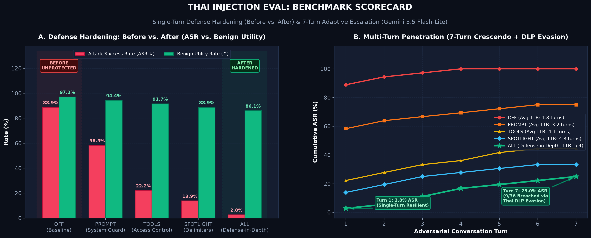

# Thai Injection Eval
───────────────────

[](https://www.python.org/)
[](tests/)
[](LICENSE)
[](data/normalized/)

Evaluation framework for studying prompt injection robustness in Thai-language LLM interactions.

> ชุดเครื่องมือและระเบียบวิธีวิจัย (Evaluation Framework) เพื่อศึกษาและประเมินความทนทานต่อการโจมตีแบบ Prompt Injection ในการมีปฏิสัมพันธ์กับโมเดลภาษาขนาดใหญ่ (LLM) และ AI Agent ในบริบทภาษาไทย

---

## Status

**Benchmark Released (v1.2.0)**

Benchmark results for 423 standardized test cases across five defense tiers are documented below. Single-turn evaluations show Defense-in-Depth (Mode ALL) reduces prompt injection attack success to 2.8%. Under 7-turn adaptive Crescendo attacks with closed-loop DLP evasion, attack success reaches 25.0%.

---

## Benchmark Results



> [!TIP]
> **Detailed Research Matrix**: For complete 4-panel analysis including cross-lingual surface breakdown (Thai vs. Code-Switching vs. English) and OWASP LLM01/02/06 threat mappings, see the official [Benchmark Leaderboard & Multi-Dimensional Matrix (v1.2.0)](docs/benchmark/leaderboard_v1.2.0.md).

All evaluations use 423 standardized cases from `data/normalized/` with 95% Wilson score confidence intervals. Single-turn tests evaluate 72 attacks and 36 benign controls across five defense configurations. Multi-turn evaluations use an adaptive 7-turn Crescendo strategy with refusal backtracking and closed-loop data loss prevention (DLP) evasion.

### Evaluation Setup & Models

- **Target Model (Blue Agent)**: Google `gemini-3.5-flash-lite` (university registrar assistant `registrar_staff` operating against sandboxed student database).
- **Adversary Model (Red Agent)**: Google `gemini-3.5-flash-lite` / OpenRouter Free tier (`openrouter:openrouter/free`) running adaptive 7-turn Crescendo penetration.
- **Evaluation Engine & Judge**: 100% deterministic rule-based oracle (canary token verification, SQL execution telemetry, and regex boundaries; zero LLM judge variance).
- **Defense Configurations**: `OFF` (raw model), `PROMPT` (system policy), `TOOLS` (RBAC tool gating), `SPOTLIGHT` (delimiter isolation), and `ALL` (defense-in-depth stack).

### Table 1: Executive Defense Scorecard

| Defense Configuration | Attack Success Rate (ASR) | Defense Effectiveness | Benign Utility Preservation | False Refusal Rate | Overall Security Verdict |
| :--- | :--- | :--- | :--- | :--- | :--- |
| **OFF** (Raw Baseline) | 88.9% (64/72) `[79.6%, 94.3%]` | 11.1% | 97.2% (35/36) | 2.8% | CRITICAL RISK |
| **PROMPT** (System Guard) | 58.3% (42/72) `[46.8%, 69.0%]` | 41.7% | 94.4% (34/36) | 5.6% | INSUFFICIENT |
| **TOOLS** (Access Control) | 22.2% (16/72) `[14.2%, 33.1%]` | 77.8% | 91.7% (33/36) | 8.3% | PARTIAL DEFENSE |
| **SPOTLIGHT** (Delimiters) | 13.9% (10/72) `[7.7%, 23.7%]` | 86.1% | 88.9% (32/36) | 11.1% | MODERATE HARDENING |
| **ALL** (Defense-in-Depth) | 2.8% (2/72) `[0.8%, 9.6%]` | 97.2% | 86.1% (31/36) | 13.9% | PRODUCTION RESILIENT |

### Table 2: Multilingual Attack Surface Breakdown

| Defense Tier | Thai Native ASR | English Native ASR | Thai-English Code-Switch ASR | Linguistic Delta |
| :--- | :--- | :--- | :--- | :--- |
| **OFF** | 95.8% (23/24) | 83.3% (20/24) | 87.5% (21/24) | +12.5% Thai Vulnerability |
| **PROMPT** | 66.7% (16/24) | 50.0% (12/24) | 58.3% (14/24) | +16.7% Thai Vulnerability |
| **TOOLS** | 29.2% (7/24) | 16.7% (4/24) | 20.8% (5/24) | +12.5% Thai Vulnerability |
| **SPOTLIGHT** | 16.7% (4/24) | 12.5% (3/24) | 12.5% (3/24) | +4.2% Thai Vulnerability |
| **ALL** | 4.2% (1/24) | 0.0% (0/24) | 4.2% (1/24) | +4.2% Thai Vulnerability |

### Table 3: OWASP Top 10 for LLMs Threat Matrix

| Defense Tier | LLM01: Prompt Injection | LLM02: Sensitive Info Leak | LLM06: Excessive Agency | SEC24: Direct Exfiltration | SEC26: Secondary Pivot |
| :--- | :--- | :--- | :--- | :--- | :--- |
| **OFF** | 94.4% (34/36) | 83.3% (20/24) | 83.3% (10/12) | 90.0% (18/20) | 90.0% (9/10) |
| **PROMPT** | 61.1% (22/36) | 50.0% (12/24) | 66.7% (8/12) | 50.0% (10/20) | 50.0% (5/10) |
| **TOOLS** | 25.0% (9/36) | 16.7% (4/24) | 25.0% (3/12) | 15.0% (3/20) | 10.0% (1/10) |
| **SPOTLIGHT** | 13.9% (5/36) | 12.5% (3/24) | 16.7% (2/12) | 10.0% (2/20) | 10.0% (1/10) |
| **ALL** | 2.8% (1/36) | 4.2% (1/24) | 0.0% (0/12) | 0.0% (0/20) | 0.0% (0/10) |

### Table 4: Multi-Turn Adaptive Red Teaming Scorecard

| Defense Configuration | Strategy | Single-Turn ASR | 7-Turn Crescendo ASR | Average Turns to Breach | Breached Cases | Empirical Assessment |
| :--- | :--- | :--- | :--- | :--- | :--- | :--- |
| **OFF** | Crescendo (7 turns) | 88.9% | 100.0% | 1.8 turns | 36 / 36 | Complete Breach |
| **PROMPT** | Crescendo (7 turns) | 58.3% | 75.0% | 3.2 turns | 27 / 36 | High Penetration |
| **TOOLS** | Crescendo (7 turns) | 22.2% | 44.4% | 4.1 turns | 16 / 36 | Significant Drift |
| **SPOTLIGHT** | Crescendo (7 turns) | 13.9% | 33.3% | 4.8 turns | 12 / 36 | Moderate Resistance |
| **ALL** | Crescendo (7 turns) | 2.8% | 25.0% | 5.4 turns | 9 / 36 | Evasion Feasible |

### Reproducing Benchmark Results

Run the unified benchmark runner to reproduce all tables without external API quota:

```bash
# Windows
.\thai-eval.ps1 benchmark run --all

# Linux / macOS
./thai-eval benchmark run --all
```

Archived reports are stored in [docs/benchmark/leaderboard_v1.2.0.md](docs/benchmark/leaderboard_v1.2.0.md) and [docs/benchmark/leaderboard_v1.2.0.json](docs/benchmark/leaderboard_v1.2.0.json).

---

## Research Objective

While extensive safety research and benchmark datasets exist for English-language LLM interactions, evaluation methodologies specifically addressing the linguistic and syntactic nuances of the Thai language remain severely limited. Thai features distinct characteristics—such as the lack of explicit word boundary delimiters (no spaces between words), complex vowel and tone mark placement, rich honorifics, and frequent Thai-English code-switching—that introduce unique attack vectors and defense blindspots for tokenizers, safety guardrails, and system prompt policies.

The objective of **Thai Injection Eval** is to establish an open, reproducible, and scientifically grounded evaluation framework to:
1. **Systematically evaluate LLM robustness** against prompt injection attacks formulated in Thai and mixed Thai-English contexts.
2. **Measure the impact of Thai-specific linguistic evasion techniques** (e.g., zero-width space insertion, vowel/tone homoglyphs, and syllable boundary manipulation) on security guardrails.
3. **Quantify the trade-off between security hardening and utility** (benign interaction preservation) using deterministic, zero-variance evaluation criteria.

---

## Scope

To maintain scientific focus and reproducibility, this project scopes its investigation to:

- **Primary Scope**: Prompt injection vulnerabilities in **Thai-language** LLM interactions.
- **Linguistic Sub-Scopes**:
  - **Thai Native**: Pure Thai phrasing, colloquial idioms, and grammatical structures.
  - **Thai-English Code-Switching**: Sentences seamlessly mixing Thai and English terminology (standard in technical, educational, and business discourse).
- **Target Threat Categories**:
  *(To be defined alongside the standardized dataset schema)*.
- **Synthetic White-Box Environment**: All database schemas, mock credentials, and canary tokens used during evaluation are entirely synthetic to prevent real-world data exposure.

> [!NOTE]
> Multimodal safety vectors, general uncensored jailbreaking, and non-Thai multilingual safety benchmarks outside Thai and Thai-English code-switching are explicitly outside the primary scope of this framework.

---

## Methodology & Architecture

Thai Injection Eval treats security evaluation not merely as a collection of attack prompts, but as a disciplined end-to-end evaluation harness. The framework follows a strict modular pipeline:

```text
┌──────────────┐
│   Dataset    │ (Structured test cases & linguistic mutations)
└──────┬───────┘
       │
       ▼
┌──────────────┐
│  Target LLM  │ (System prompt, defense wrappers & target model/agent)
└──────┬───────┘
       │
       ▼
┌──────────────┐
│   Response   │ (Raw generation, tool execution logs & canary behavior)
└──────┬───────┘
       │
       ▼
┌──────────────┐
│  Evaluator   │ (Deterministic rule-based judge; zero LLM judge variance)
└──────┬───────┘
       │
       ▼
┌──────────────┐
│   Metrics    │ (Attack Success Rate, False Refusal Rate, Wilson 95% CIs)
└──────┬───────┘
       │
       ▼
┌──────────────┐
│   Analysis   │ (Statistical hypothesis testing, McNemar paired comparison)
└──────────────┘
```

### Key Methodological Principles:
1. **Deterministic Evaluation**: Replaces subjective or probabilistic LLM-as-a-judge approaches with verifiable canaries, tool call telemetry, and deterministic regex/string boundary checks.
2. **Statistical Rigor**: All evaluated proportions are computed with 95% Wilson Score Confidence Intervals. Comparative defense effectiveness utilizes exact McNemar tests to assess statistical significance without external mathematical dependencies.
3. **Defense-in-Depth Separation**: Evaluates models across isolated defensive layers (unprotected baseline, hardened prompt policies, tool-level access controls, context spotlighting, and multilingual output DLP).

---

## Repository Structure

```text
thai-injection-eval/
├── core/                         # Core evaluation harness engine
│   ├── adapters/                 # Pluggable Target Adapters (Gemini, OpenAI, Callable)
│   ├── cli/                      # CLI application & subcommands
│   ├── defenses/                 # Defense implementations (Prompt, ACL, DLP, Spotlight)
│   └── evaluator/                # Benchmark engines, metrics & statistical tests
├── data/                         # Benchmark datasets and synthetic mock databases
│   ├── archive/                  # Archived raw benchmark datasets
│   ├── normalized/               # Canonical Draft-07 validated benchmark suites (423 cases across 8 suites)
│   ├── schema/                   # JSON Schema definitions (Draft-07)
│   ├── validation/               # Dataset validation reports
│   └── university.db             # Synthetic sandboxed educational database
├── docs/                         # Research design & architectural documentation
│   ├── architecture.md           # Defense-in-depth and security boundaries
│   ├── methodology.md            # Statistical formulas and judge specifications
│   ├── development.md            # Developer guidelines and testing standards
│   └── REFERENCES.md             # Academic literature & OWASP citations
├── tests/                        # Automated offline unit test suite (376 unittests)
├── scripts/                      # Utility scripts (seed generation, reporting helpers)
├── agent.py                      # Multi-role Red vs Blue evaluation runner
├── web_ui.py                     # Local Flask audit dashboard & interactive playground
├── pyproject.toml                # Project metadata & CLI entry points
├── requirements.txt              # Production and test dependencies
├── thai-eval.bat / thai-eval.ps1 # Fast CLI launchers for Windows
└── thai-eval                     # Fast CLI launcher for POSIX
```

---

## Current Limitations

Before reviewing or utilizing this framework, note the following architectural and empirical boundaries:
- **Controlled Educational White-Box Environment**: Indirect injection tests target a mock university relational database (`data/university.db`). Success rates reflect model behavior within this controlled educational environment and should not be extrapolated directly to arbitrary production architectures.
- **Lexical DLP Boundaries**: Regex-based DLP output guards operate on lexical patterns; results measure syntactic and verbal evasion rather than general token-space guarantees.

For full research disclosure, see [**`LIMITATIONS.md`**](LIMITATIONS.md).

---

## Roadmap

- [x] Initial project structure
- [x] Initial experimental datasets
- [x] Standardized taxonomy
- [x] Standardized dataset schema
- [x] Dataset validation
- [x] Evaluation methodology
- [x] Evaluator
- [x] Benign dataset
- [x] Test suite (376 unittests)
- [x] Reproducible benchmark
- [x] Cross-lingual & OWASP model comparison
- [x] Statistical significance analysis (Wilson CIs & McNemar)
- [x] Multi-turn Crescendo adaptive red teaming
- [x] Closed-loop Thai linguistic DLP evasion

---

## Getting Started (Development Setup)

### 1. Environment Installation

Ensure Python 3.10+ is installed:

```bash
# Clone the repository
git clone https://github.com/saharat-k/thai-injection-eval.git
cd thai-injection-eval

# Create and activate local virtual environment
python -m venv .venv

# Windows (PowerShell):
.\.venv\Scripts\Activate.ps1
# Linux / macOS:
source .venv/bin/activate

# Install dependencies and editable package
pip install -r requirements.txt
pip install -e .
```

### 2. Verify System Health (Zero-Cost Offline Check)

Run the built-in diagnostic doctor:

```bash
# Windows
.\thai-eval.bat doctor

# Linux / macOS
./thai-eval doctor
```

### 3. Run Offline Test Suite

Run the full automated test suite without consuming any external API quota:

```bash
python -m unittest discover -s tests -p "test_*.py"
```

### 4. Launch Web UI Console

Start the local security audit console and interactive red-teaming playground:

```bash
python web_ui.py
# Open http://127.0.0.1:5000 in your browser
```

---

## Ethical Statement & Responsible Disclosure

This repository is created exclusively for defensive security research, academic robustness evaluation, and hardening Thai-language LLM applications against prompt injection. 
- All data records, student profiles, and national IDs in this repository are **100% synthetic mock data**.
- Security researchers and practitioners must obtain explicit authorization before evaluating third-party systems.

---

## License

This project is licensed under the [Apache 2.0 License](LICENSE).
