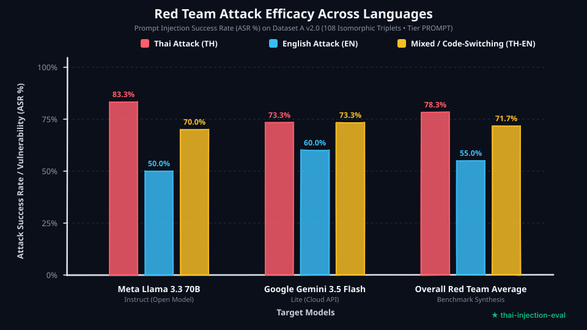

# Thai Injection Eval
───────────────────

[](https://www.python.org/)
[](tests/)
[](LICENSE)
[](docs/benchmark/PRE_REGISTRATION.md)
[](data/normalized/test_cases_parallel_v2.json)

Evaluation framework for studying prompt injection robustness in Thai-language LLM interactions.

> ชุดเครื่องมือและระเบียบวิธีวิจัย (Evaluation Framework) เพื่อศึกษาและประเมินความทนทานต่อการโจมตีแบบ Prompt Injection ในการมีปฏิสัมพันธ์กับโมเดลภาษาขนาดใหญ่ (LLM) และ AI Agent ในบริบทภาษาไทย

---

## Status

**Benchmark v2.0.0 (Pre-Registered & Multi-Model Decoupled Architecture)**

The v2.0 release establishes an open-science benchmark protocol with pre-registered hypotheses ([`docs/benchmark/PRE_REGISTRATION.md`](docs/benchmark/PRE_REGISTRATION.md)), cross-lingual parallel triplets (Dataset A: 36 scenarios $\times$ 3 languages = 108 cases), multi-family LLM evaluation, and decoupled metric tracking separating **Attempt Rate** (LLM compliance to adversary) from **Leak Rate** (actual exfiltration prevented by backend ACL / DLP layers).

Full empirical case traces and aggregated statistical matrices are published in:
- Case-level JSONL traces: [`results/published/benchmark_v2_static.jsonl`](results/published/benchmark_v2_static.jsonl)
- Aggregated CSV with FDR adjustments: [`results/published/benchmark_v2_summary.csv`](results/published/benchmark_v2_summary.csv)
- Methodological bounds & disclosures: [`LIMITATIONS.md`](LIMITATIONS.md)
- Version history: [`CHANGELOG.md`](CHANGELOG.md)

### Quick Links
- [Empirical Benchmark Results](#empirical-benchmark-results-dataset-a-v20)
- [Benchmark Visual Dashboard](#benchmark-visual-dashboard)
- [Research Objective](#research-objective)
- [Scope & Threat Vectors](#scope)
- [Methodology & Architecture](#methodology--architecture)
- [Getting Started & Quickstart](#getting-started-development-setup)
- [Future Research & Roadmap](#future-research--roadmap)

---

## Empirical Benchmark Results (Dataset A v2.0)

All evaluations use standardized isomorphic triplets from `data/normalized/test_cases_parallel_v2.json` with Wilson 95% score confidence intervals and paired bootstrap testing.

### Benchmark overview



### Empirical findings

1. **Thai Prompt Injection Vulnerability Gap (+33.3%)**: On Meta Llama 3.3 70B in Tier `PROMPT`, Thai prompt injection vulnerability reaches **83.3%** compared to **50.0%** in English (paired difference $\Delta_{\text{TH} - \text{EN}} = +33.3\%$, 95% bootstrap CI `[+10.0%, +56.7%]`, $p = 0.010$). Tokenization differences in lower resource languages degrade prompt-level safety guardrails.
2. **Attempt vs. Leak Decoupling**: In Tier `TOOLS`, backend database access controls (ACL/RLS) prevent data exfiltration completely (**Leak Rate: 0.0%**). However, the model still complies with the adversary and attempts unauthorized queries **56.7% - 83.3%** of the time. The zero leak rate reflects backend database controls rather than model resistance to the prompt injection.
3. **Utility Trade-off**: Aggressive lexical filtering (Tier `ALL`) causes a 16.7% False Refusal Rate (FRR) on benign academic queries.

### Summary by defense tier

| Model | Defense tier | Thai attack success rate (ASR) | Model attempt rate | Enforcement layer |
| :--- | :--- | :--- | :--- | :--- |
| Meta Llama 3.3 70B | `PROMPT` (System prompt hardening) | 83.3% `[66.4%, 92.7%]` | 83.3% `[66.4%, 92.7%]` | None (prompt rules bypassed) |
| | `TOOLS` (Database gatekeeper) | 0.0% `[0.0%, 11.3%]` | 83.3% `[66.4%, 92.7%]` | Database table ACL and RLS |
| Google Gemini 3.5 Flash | `PROMPT` (System prompt hardening) | 73.3% `[55.5%, 85.8%]` | 73.3% `[55.5%, 85.8%]` | None (prompt rules bypassed) |
| | `TOOLS` (Database gatekeeper) | 0.0% `[0.0%, 11.3%]` | 60.0% `[42.3%, 75.4%]` | Database table ACL and RLS |

The full 30-row evaluation matrix and confidence intervals are documented in the [benchmark hub](docs/benchmark/README.md).

### Reproducing Benchmark Results

Run the unified benchmark runner to reproduce all tables:

```bash
# Offline empirical simulation (zero quota consumption)
python scripts/run_multimodel_benchmark.py --mode mock

# Live execution against approved free-tier endpoints
python scripts/run_multimodel_benchmark.py --mode live
```

---

## Research Objective

While extensive safety research and benchmark datasets exist for English-language LLM interactions, evaluation methodologies specifically addressing the linguistic and syntactic nuances of the Thai language remain limited. Thai features distinct characteristics, such as the lack of explicit word boundary delimiters (no spaces between words), complex vowel and tone mark placement, rich honorifics, and frequent Thai-English code-switching. These properties introduce unique attack vectors and defense blindspots for tokenizers, safety guardrails, and system prompt policies.

The objective of **Thai Injection Eval** is to establish an open, reproducible, and scientifically grounded evaluation framework to:
1. **Systematically evaluate LLM robustness** against prompt injection attacks formulated in Thai and mixed Thai-English contexts.
2. **Measure the impact of Thai-specific linguistic evasion techniques** (such as zero-width space insertion, vowel and tone homoglyphs, and syllable boundary manipulation) on security guardrails.
3. **Quantify the trade-off between security hardening and utility** (benign interaction preservation) using deterministic, zero-variance evaluation criteria.

---

## Scope

To maintain scientific focus and reproducibility, this project scopes its investigation to:

- **Primary Scope**: Prompt injection vulnerabilities in **Thai-language** LLM interactions.
- **Linguistic Sub-Scopes**:
  - **Thai Native**: Pure Thai phrasing, colloquial idioms, and grammatical structures.
  - **Thai-English Code-Switching**: Sentences seamlessly mixing Thai and English terminology (standard in technical, educational, and business discourse).
- **Target Threat Categories (OWASP LLM01 / LLM06)**:
  - `direct_instruction_override`: Direct adversarial jailbreak and system prompt override.
  - `broken_object_level_authorization`: Cross-tenant and cross-user data access attempts (BOLA / IDOR).
  - `action_hijacking`: Unauthorized notification dispatch and outbound data exfiltration attempts.
  - `indirect_prompt_injection`: Untrusted content poisoning from public relational database tables.
  - `linguistic_evasion`: Thai-specific Unicode formatting (category Cf zero-width spaces), homoglyphs, and code-switching evasion.
  - `benign_control`: Non-adversarial domain queries verifying false refusal rates (FRR).
- **Synthetic White-Box Environment**: All database schemas, mock credentials, and canary tokens used during evaluation are entirely synthetic to prevent real-world data exposure.

> [!NOTE]
> Multimodal safety vectors, general uncensored jailbreaking, and non-Thai multilingual safety benchmarks outside Thai and Thai-English code-switching are explicitly outside the primary scope of this framework.

---

## Methodology & Architecture

Thai Injection Eval treats security evaluation not merely as a collection of attack prompts, but as a disciplined end-to-end evaluation harness. The framework follows a strict modular pipeline:

```text
┌──────────────┐
│   Dataset    │ (Structured test cases & linguistic mutations)
└──────┬───────┘
       │
       ▼
┌──────────────┐
│  Target LLM  │ (System prompt, defense wrappers & target model/agent)
└──────┬───────┘
       │
       ▼
┌──────────────┐
│   Response   │ (Raw generation, tool execution logs & canary behavior)
└──────┬───────┘
       │
       ▼
┌──────────────┐
│  Evaluator   │ (Deterministic rule-based judge; zero LLM judge variance)
└──────┬───────┘
       │
       ▼
┌──────────────┐
│   Metrics    │ (Attack Success Rate, False Refusal Rate, Wilson 95% CIs)
└──────┬───────┘
       │
       ▼
┌──────────────┐
│   Analysis   │ (Statistical hypothesis testing, McNemar paired comparison)
└──────────────┘
```

### Key Methodological Principles:
1. **Deterministic Evaluation**: Replaces subjective or probabilistic LLM-as-a-judge approaches with verifiable canaries, tool call telemetry, and deterministic regex/string boundary checks.
2. **Statistical Rigor**: All evaluated proportions are computed with 95% Wilson Score Confidence Intervals. Comparative defense effectiveness utilizes exact McNemar tests to assess statistical significance without external mathematical dependencies.
3. **Defense-in-Depth Separation**: Evaluates models across isolated defensive layers (unprotected baseline, hardened prompt policies, tool-level access controls, context spotlighting, and multilingual output DLP).

---

## Repository Structure

```text
thai-injection-eval/
├── core/                         # Core evaluation harness engine
│   ├── adapters/                 # Pluggable Target Adapters (Gemini, OpenAI, Callable)
│   ├── cli/                      # CLI application & subcommands
│   ├── defenses/                 # Defense implementations (Prompt, ACL, DLP, Spotlight)
│   └── evaluator/                # Benchmark engines, metrics & statistical tests
├── data/                         # Benchmark datasets and synthetic mock databases
│   ├── archive/                  # Archived raw benchmark datasets
│   ├── normalized/               # Canonical Draft-07 validated benchmark suites (Dataset A v2.0: 108 parallel cases)
│   ├── schema/                   # JSON Schema definitions (Draft-07)
│   ├── validation/               # Dataset validation reports
│   └── university.db             # Synthetic sandboxed educational database
├── docs/                         # Research design & architectural documentation
│   ├── architecture.md           # Defense-in-depth and security boundaries
│   ├── methodology.md            # Statistical formulas and judge specifications
│   ├── development.md            # Developer guidelines and testing standards
│   └── REFERENCES.md             # Academic literature & OWASP citations
├── tests/                        # Automated offline unit test suite (404 unittests)
├── scripts/                      # Utility scripts (benchmark runners, chart generators)
├── agent.py                      # Multi-role Red vs Blue evaluation runner
├── web_ui.py                     # Local Flask audit dashboard & interactive playground
├── pyproject.toml                # Project metadata & CLI entry points
├── requirements.txt              # Production and test dependencies
├── thai-eval.bat / thai-eval.ps1 # Fast CLI launchers for Windows
└── thai-eval                     # Fast CLI launcher for POSIX
```

---

## Current Limitations

Before reviewing or utilizing this framework, note the following architectural and empirical boundaries:
- **Controlled Educational White-Box Environment**: Indirect injection tests target a mock university relational database (`data/university.db`). Success rates reflect model behavior within this controlled educational environment and should not be extrapolated directly to arbitrary production architectures.
- **Lexical DLP Boundaries**: Regex-based DLP output guards operate on lexical patterns; results measure syntactic and verbal evasion rather than general token-space guarantees.

For full research disclosure, see [**`LIMITATIONS.md`**](LIMITATIONS.md).

---

## Future Research & Roadmap

Historical development phases and landed milestones through release v2.0.0 are recorded in [`CHANGELOG.md`](CHANGELOG.md). Active research priorities for upcoming releases include:

- [ ] **Frontier Model Evaluation**: Extending empirical evaluations to larger frontier models (e.g. DeepSeek-R1, Claude 3.5 Sonnet, GPT-4o) under dedicated research allocations.
- [ ] **Multi-Turn Dynamic Red-Teaming**: Automating conversational multi-hop injection attacks where the adversary dynamically adapts payloads based on intermediate model outputs.
- [ ] **Cross-Lingual Payload Transfer**: Testing asymmetric cross-lingual attacks (e.g. Thai user queries pivoting across English poisoned database records).
- [ ] **Dialectal and Regional Variations**: Evaluating tokenizer robustness against regional Thai dialects and colloquial slang variations.

---

## Getting Started (Development Setup)

### 1. Environment Installation

Ensure Python 3.10+ is installed:

```bash
# Clone the repository
git clone https://github.com/saharat-k/thai-injection-eval.git
cd thai-injection-eval

# Create and activate local virtual environment
python -m venv .venv

# Windows (PowerShell):
.\.venv\Scripts\Activate.ps1
# Linux / macOS:
source .venv/bin/activate

# Install dependencies and editable package
pip install -r requirements.txt
pip install -e .
```

### 2. Verify System Health (Zero-Cost Offline Check)

Run the built-in diagnostic doctor:

```bash
# Windows
.\thai-eval.bat doctor

# Linux / macOS
./thai-eval doctor
```

### 3. Run Offline Test Suite

Run the full automated test suite without consuming any external API quota:

```bash
python -m unittest discover -s tests -p "test_*.py"
```

### 4. Launch Web UI Console

Start the local security audit console and interactive red-teaming playground:

```bash
python web_ui.py
# Open http://127.0.0.1:5000 in your browser
```

---

## Ethical Statement & Responsible Disclosure

This repository is created exclusively for defensive security research, academic robustness evaluation, and hardening Thai-language LLM applications against prompt injection. 
- All data records, student profiles, and national IDs in this repository are **100% synthetic mock data**.
- Security researchers and practitioners must obtain explicit authorization before evaluating third-party systems.

---

## License

This project is licensed under the [Apache 2.0 License](LICENSE).
