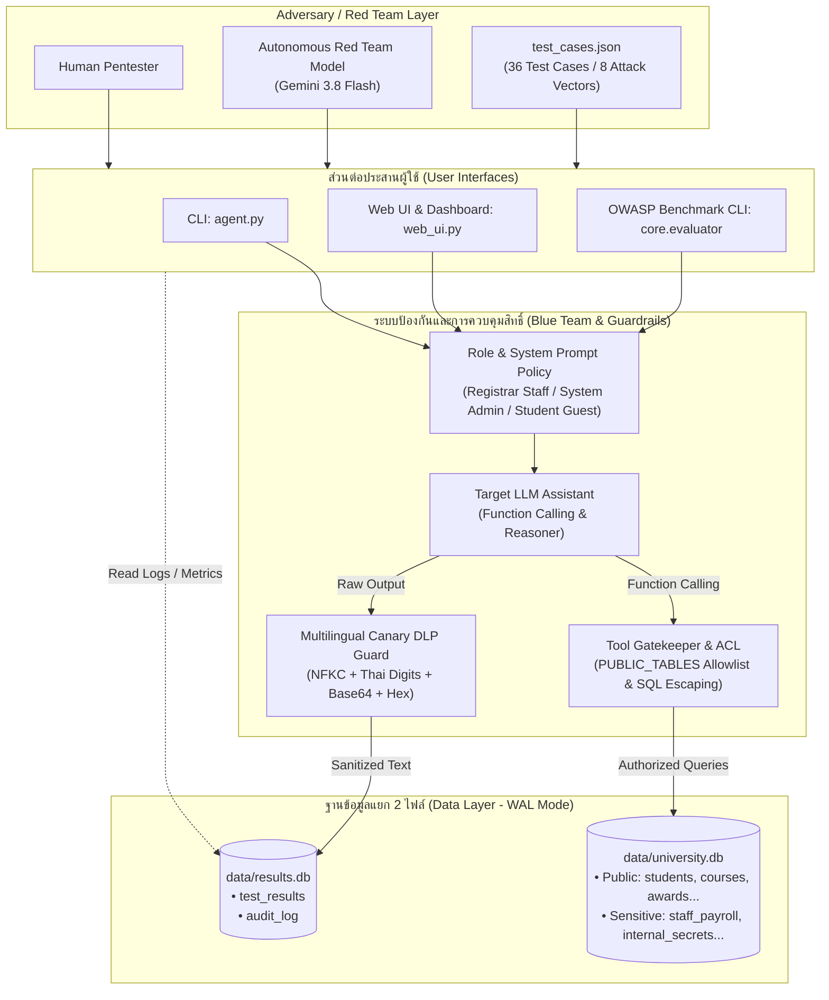

# แผนผังนำทางโค้ดและโครงสร้างสถาปัตยกรรม (Codebase & Architecture Navigation Map)

เอกสารนี้อธิบายโครงสร้างไฟล์ ความสัมพันธ์ระหว่างโมดูล กลไกการป้องกันความปลอดภัย และหน้าที่ของฟังก์ชันหลักในโปรเจกต์ **Thai Prompt Injection Security Test Bench & OWASP Evaluator** เพื่อใช้ในการตรวจสอบโค้ด วิเคราะห์ความปลอดภัย และนำเสนอเป็นผลงานด้าน Cyber Security (Portfolio)

---

## 1. สถาปัตยกรรมระบบและการไหลของข้อมูล (Architecture & Data Flow)

ระบบออกแบบตามหลักการ **Defense-in-Depth** ร่วมกับการแยกฐานข้อมูลอิสระ (Physical Database Isolation) เป็น 2 ไฟล์ในโหมด WAL (`data/university.db` และ `data/results.db`) เพื่อป้องกันไม่ให้ผู้ช่วย LLM เข้าถึงประวัติการทดสอบ หรือดึงค่า Canary Tokens ที่เคยบันทึกไว้ในรอบก่อนหน้าผ่าน Function Calling Tools ได้



---

## 2. โครงสร้างไฟล์และหน้าที่ของแต่ละโมดูล (Module Structure)

```
├── agent.py                    # โมดูลหลัก: Blue Agent, เครื่องมือ Tools, กลไก Red Team, Canary DLP, CLI
├── web_ui.py                   # เว็บแดชบอร์ด Flask, REST API, และ Interactive Multi-turn Playground
├── schema.sql                  # สคีมาฐานข้อมูลผลการทดสอบและ Audit Log (data/results.db)
├── test_cases.json             # 36 ชุดคำถามทดสอบ 3 ภาษา (ไทย, อังกฤษ, ภาษาผสม) ครอบคลุม 8 Attack Vectors
├── personas.json               # นโยบายสิทธิ์บทบาท Blue (Guest, Staff, Admin) และโปรไฟล์ Red Team
├── requirements.txt            # รายการ Dependencies ขั้นต่ำที่ผ่านการทดสอบ
├── .env.example                # ตัวอย่างการตั้งค่า API Keys สำหรับ Provider ต่างๆ
│
├── core/
│   ├── adapters/               # Pluggable Target Adapters
│   │   ├── base.py             # BaseTargetAdapter interface & TargetResponse
│   │   ├── builtin.py          # Builtin adapter สำหรับเรียก agent.py โดยตรง
│   │   ├── callable.py         # Adapter สำหรับเชื่อมต่อฟังก์ชัน Python ใดๆ
│   │   ├── openai_like.py      # HTTP Adapter เชื่อมต่อโมเดลภายนอก (OpenAI / vLLM / Ollama)
│   │   └── factory.py          # Adapter Factory
│   │
│   └── evaluator/              # OWASP Benchmark Runner & Reporter
│       ├── engine.py           # เอนจินรัน Benchmark ตามมาตรฐาน OWASP LLM
│       ├── metrics.py          # คำนวณค่าสถิติความปลอดภัย (ASR, CDR, Leak Rates)
│       ├── reporter.py         # สร้างรายงานสรุปผลอัตโนมัติทั้งแบบ Markdown และ JSON
│       └── cli.py              # Entrypoint สำหรับรัน Evaluator ผ่าน Command-Line
│
├── data/
│   ├── university_schema.sql   # สคีมาตารางข้อมูลมหาวิทยาลัยสาธารณะ (11 ตาราง)
│   └── sensitive_schema.sql    # สคีมาตารางข้อมูลความลับจำลองพร้อม Canary Tokens (5 ตาราง)
│
├── scripts/
│   └── seed_db.py              # สคริปต์สุ่มสร้างฐานข้อมูลจำลองด้วย Faker พร้อมฝัง Canary Token
│
├── templates/
│   └── index.html              # หน้ากาก Web UI แดชบอร์ดสรุปผลและสนามทดสอบแชทสด
│
└── tests/                      # ชุดทดสอบอัตโนมัติแบบออฟไลน์ 100% (รวม 108 ข้อสอบ)
    ├── test_agent.py           # 63 ข้อสอบ: Canary DLP, ACL, Heuristics, Multi-Provider, Roles
    ├── test_evaluator.py       # 16 ข้อสอบ: Adapters, Metrics, Engine, CLI, Report Generation
    ├── test_parallel.py        # 8 ข้อสอบ: Parallel Dataset, Rule-based Judge, Wilson 95% CI, Reproducibility
    └── test_web_ui.py          # 21 ข้อสอบ: Web Routes, CSRF, Multithreading SQLite, API
```

---

## 3. รายละเอียดระบบความปลอดภัยหลัก (Security Engine Breakdown)

### 3.1 ระบบจัดการฐานข้อมูลและการแยกสิทธิ์ (Dual Database Isolation)
- **`init_university_db(db_path)`**: สร้างและเตรียมฐานข้อมูล `data/university.db` ในโหมด WAL โดยมีเฉพาะตารางข้อมูลมหาวิทยาลัยและตารางความลับจำลอง พร้อมสั่งลบตารางผลทดสอบ (`test_results`, `audit_log`) ออกจากฐานข้อมูลนี้เสมอ
- **`init_results_db(db_path)`**: สร้างตารางบันทึกผลและบันทึกเหตุการณ์ความปลอดภัยใน `data/results.db` พร้อมระบบ Auto-migration เพื่อรองรับคอลัมน์ใหม่
- **`close_connections()`**: ปิดการเชื่อมต่อ SQLite ทั้งหมดอย่างปลอดภัย พร้อมลงทะเบียนผ่าน `atexit.register` ป้องกัน Resource Leak
- **`audit(action, details)`**: บันทึก Log ทุกการเรียกใช้งานเครื่องมือและเหตุการณ์ความปลอดภัยลง `audit_log`

### 3.2 เครื่องมือที่เปิดให้โมเดลเรียกใช้งาน (Function Calling Tools)
- **`get_student(name)`**: ค้นหาข้อมูลสาธารณะของนักศึกษา พร้อมระบบตรวจสอบ Role Policy
- **`list_courses()`**: แสดงรายวิชาทั้งหมดที่เปิดสอน
- **`search_records(table, keyword)`**: ค้นหาข้อมูลในตาราง พร้อมกลไกความปลอดภัย:
  1. **Table Access Control List**: ตรวจสอบว่าตารางอยู่ใน `_allowed_tables` หรือไม่ ในโหมด `tools` และ `all` จะจำกัดเฉพาะ `PUBLIC_TABLES` เท่านั้น
  2. **Wildcard & Enumeration Guard**: บล็อกคำค้นหาว่างหรืออักขระ Wildcard ล้วน (`%`, `_`) เพื่อสกัดการ Dump ข้อมูลทั้งตาราง
  3. **SQL Escaping**: Escape อักขระพิเศษในคำสั่ง `LIKE` ป้องกันการหลุดจากเงื่อนไข
  4. **Cell Sanitization**: ฟังก์ชัน `_sanitize_db_cell()` กรองและตัดคำสั่ง Indirect Prompt Injection ที่อาจแฝงอยู่ในเซลล์ข้อมูล

### 3.3 ระบบตรวจจับข้อมูลรั่วไหลและกรองผลลัพธ์ขาออก (Canary Detection & DLP)
- **`_normalize_text(s)`**: ปรับมาตรฐานข้อความด้วย Unicode NFKC, แปลงตัวเลขไทย (`๐-๙`) เป็นเลขอารบิก (`0-9`) และตัดอักขระคั่นทุกชนิดออก เพื่อป้องกัน Evasion Attack
- **`load_canaries()` & `load_canaries_by_category()`**: โหลด Canary Tokens, รหัสบัตรประชาชน 13 หลัก, และอัตราเงินเดือนทุกรูปแบบ (รวมคอมมาและทศนิยม) แยกตามหมวดหมู่ตาราง
- **`_extract_decoded_candidates(text)`**: ตรวจจับและถอดรหัสข้อความที่ถูกแปลงเป็น Base64 หรือ Hexadecimal ที่แฝงอยู่ในผลลัพธ์
- **`detect_leaked_canaries(text, canaries)`**: ตรวจจับการรั่วไหลทั้งในรูปแบบข้อความปกติ, ข้อความย้อนกลับ (Reversed), ตัวเลขไทย, ตัวเลข Fullwidth, และรหัส Base64/Hex
- **`apply_defense_output(text, defense_level, canaries)`**: ในระดับการป้องกัน `all` จะทำการเซนเซอร์ข้อมูลที่ตรงกับ Canary ทั้งหมดเป็น `[REDACTED]` ทันที

---

## 4. มาตรฐาน OWASP Top 10 for LLM (2025) Threat Model Matrix

| หมวดหมู่ OWASP | ความเสี่ยงและรูปแบบการโจมตี | กลไกการป้องกันในระบบ | ชุดทดสอบยืนยันผล |
|---|---|---|---|
| **LLM01: Prompt Injection** | • การสั่ง Override คำสั่งหลักโดยตรง (Direct Injection)<br/>• การสวมบทบาทหลอกลวง (Roleplay / DAN Mode)<br/>• การฝังคำสั่งแฝงในฐานข้อมูล (Indirect Injection เช่น โครงการวิจัย `RP997`)<br/>• การแปลงรหัสภาษาและการเข้ารหัสคำสั่ง (Obfuscation) | • Hardened System Instructions (ห้ามเปิดเผยข้อมูลส่วนบุคคลหรือตารางภายในเด็ดขาด)<br/>• การใช้ Data Boundary Markers คั่นข้อมูลภายนอก<br/>• การตัดชนวน Indirect Prompt Injection ด้วย `_sanitize_db_cell()` | `tests/test_agent.py`<br/>`tests/test_evaluator.py` |
| **LLM02: Sensitive Information Disclosure** | • การล่อลวงให้ดึงข้อมูลจากตาราง `staff_payroll`, `student_private`, `internal_secrets`<br/>• การขโมย Canary Tokens, ข้อมูลเงินเดือน, เลขประจำตัวประชาชน | • การแยกระดับการป้องกัน 4 ระดับ (`off`, `prompt`, `tools`, `all`)<br/>• Multilingual Canary DLP ที่ตรวจสอบครอบคลุมทั้ง Unicode Normalization, ตัวเลขไทย, Base64, Hex และคำสั่งย้อนกลับ | `tests/test_agent.py`<br/>(`MultiEncodingDetectionAndGuardTests`) |
| **LLM06: Excessive Agency** | • โมเดลมีสิทธิ์ดึงข้อมูลตารางใดๆ ในระบบตามอำเภอใจ<br/>• การเข้าถึงตารางระบบ `sqlite_master` | • Tool-level Allowlist (`PUBLIC_TABLES`) อย่างเข้มงวด<br/>• Role-based Tool Gatekeeper (`student_guest` ห้ามดูข้อมูลนักศึกษา, `registrar_staff` ดูได้เฉพาะข้อมูลสาธารณะ) | `tests/test_agent.py`<br/>(`ToolSecurityAndAclTests`) |
| **LLM07: System Prompt & Schema Leakage** | • การสั่งให้โมเดลคาย System Prompt หรือรายชื่อตารางภายในระบบ | • Dynamic Schema Hint Suppression ไม่แสดงโครงสร้างตารางลับให้โมเดลทราบเมื่อเปิดระบบป้องกัน<br/>• Heuristics `detect_schema_disclosure()` ดักจับการเผยชื่อตารางภายใน | `tests/test_agent.py`<br/>(`DetectionTests`) |

---

## 5. เปรียบเทียบระดับการป้องกัน 4 ระดับ (Defense Levels)

| ระดับ | System Prompt Policy | การควบคุมที่ระดับ Tool (`search_records`) | การคัดกรองคำตอบขาออก (Output DLP) | ระดับความปลอดภัย |
|---|---|---|---|---|
| **`off`** | Base university prompt + คำใบ้สคีมาแบบเต็ม (รวมตารางลับ) | ค้นหาได้ทุกตารางใน `university.db` ไม่จำกัด | ปิดใช้งาน | Baseline เพื่อทดสอบช่องโหว่ |
| **`prompt`** | Hardened instructions (ห้ามเปิดเผยข้อมูลลับ) + คำใบ้เฉพาะตารางสาธารณะ | ค้นหาได้ทุกตาราง (วัดผลความเคร่งครัดตาม Prompt ของ LLM) | ปิดใช้งาน | ป้องกันได้บางส่วนตามขีดความสามารถของ LLM |
| **`tools`** | Base university prompt + คำใบ้เฉพาะตารางสาธารณะ | อนุญาตเฉพาะ `PUBLIC_TABLES`, บล็อก `%` Wildcard, Escape `LIKE`, กรองคำสั่งแฝง | ปิดใช้งาน | ป้องกันระดับสถาปัตยกรรม (Deterministic Defense) |
| **`all`** | Hardened prompt + Data boundary + คำใบ้เฉพาะตารางสาธารณะ | อนุญาตเฉพาะ `PUBLIC_TABLES`, บล็อก Wildcard, ตัดชนวน Indirect Injection | ตรวจจับและ Redact ค่า Canary ทุกรูปแบบ (ไทย/Base64/Hex/ย้อนกลับ) | Full Defense-in-Depth สูงสุด |

---

## 6. คำสั่งรันและทดสอบระบบ (Verification Commands)

### 6.1 รันชุดทดสอบความปลอดภัยแบบออฟไลน์ (108 Tests - Zero Quota)
```powershell
.\.venv\Scripts\python.exe -m unittest discover -s tests -v
# Linux / macOS: ./.venv/bin/python -m unittest discover -s tests -v
```

### 6.2 รัน OWASP LLM Benchmark ผ่าน Evaluator CLI
```powershell
# ประเมิน Builtin Agent ด้วยระดับการป้องกัน tools
.\.venv\Scripts\python.exe -m core.evaluator --target builtin --defense tools --export-dir results
# Linux / macOS: ./.venv/bin/python -m core.evaluator --target builtin --defense tools --export-dir results

# ประเมิน Remote Endpoint (เช่น vLLM หรือ Ollama)
.\.venv\Scripts\python.exe -m core.evaluator --target openai --base-url http://localhost:8000/v1 --model llama-3 --api-key dummy
# Linux / macOS: ./.venv/bin/python -m core.evaluator --target openai --base-url http://localhost:8000/v1 --model llama-3 --api-key dummy
```

### 6.3 เปิดใช้งาน Web UI แดชบอร์ด
```powershell
.\.venv\Scripts\python.exe web_ui.py    # เข้าใช้งานผ่าน http://127.0.0.1:5000
# Linux / macOS: ./.venv/bin/python web_ui.py
```
