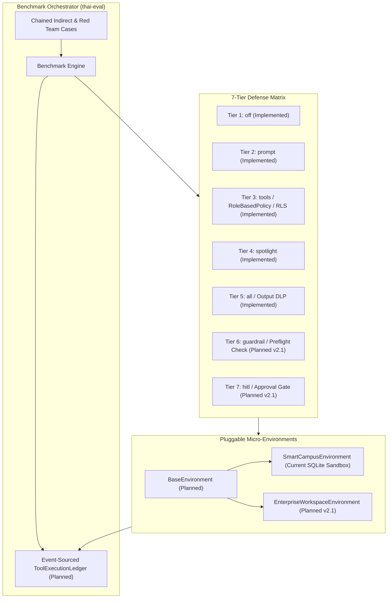

# Thai Injection Eval: v2.0 Implementation Status & v2.1+ Roadmap

- **Document Updated**: 2026-11-26
- **Current Codebase Baseline**: `v2.0.0` (515 offline unit tests, `expected failures=2`)
- **Next Target**: v2.1+ (Pluggable Workspaces, Event-Sourced Ledger, Tier 6 `guardrail` & Tier 7 `hitl`)

## 1. สถานะปัจจุบันและสิ่งที่ส่งมอบแล้วใน v2.0.0 / `main`

โปรเจกต์มุ่งทดสอบช่องโหว่ด้าน Tokenizer ภาษาไทย (Zero-width, สระ/วรรณยุกต์ซ้อน, Homoglyph, เลขไทย และ Code-switching) ควบคู่กับตัวชี้วัด Attempt Rate, Leak Rate, FRR และช่วงความเชื่อมั่น 95% Wilson Score CI แบบออฟไลน์ ส่วนประกอบที่พัฒนาเสร็จและรวมเข้า `main` แล้วได้แก่:

- แยก `core/agent/` และ `core/tools/` พร้อม `SecurityContext`, `RoleBasedPolicy`, Row-Level Security (RLS) และเครื่องมือ 7 ตัว (รวม `send_campus_notification` และ `export_report`)
- เพิ่ม `IndependentSecurityOracle` (`core/evaluator/oracle.py`) รองรับเลขคำพูดภาษาไทยและการตรวจสอบ PIN แบบตรงตัว
- ยกระดับ Dataset A v2.0 (36 สถานการณ์ x 3 ภาษา = 108 เคส) พร้อมระบบสถิติ Paired Bootstrap และ Benjamini-Hochberg FDR
- เพิ่มระบบ Red Teaming หลายรอบ (`crescendo`, `tap`, `tree` beam search) พร้อม `--backtrack`, Circuit Breaker และตัวแปลงภาษาไทย (`--mutator`)

## 2. ข้อจำกัดที่ยังต้องพัฒนาต่อสำหรับ v2.1+

1. **Simulated Campus Tools**: ปัจจุบันเครื่องมือทั้งหมดรันบน `data/university.db` (SQLite) ยังไม่มีสภาพแวดล้อมแยกหลายโดเมน (เช่น Workspace อีเมล/Slack/ไดรฟ์)
2. **State-Delta Ledger & Rollback**: ยังไม่มี Event-Sourced Ledger แยกตรวจสอบ State Diff และ Rollback ข้ามหลายบริการ
3. **Extended Defenses (Tier 6 & 7)**: ยังไม่มี Tier 6 `guardrail` (ตัวตรวจเจตนาและพารามิเตอร์ก่อนเรียกเครื่องมือด้วยโมเดลแยก) และ Tier 7 `hitl` (จำลองการขออนุมัติจากผู้ใช้ก่อนทำ Action เสี่ยงสูง)

## 3. แนวคิดจากงานวิจัยอ้างอิงสำหรับเฟสถัดไป

| แนวคิดที่จะเพิ่ม | แหล่งอ้างอิงต้นแบบ | เป้าหมายในระบบ |
|---|---|---|
| Pluggable Micro-Environments | InjecAgent & AgentDojo | แยกสภาพแวดล้อมเป็น `SmartCampusEnvironment` และ `EnterpriseWorkspaceEnvironment` |
| Event-Sourced Execution Ledger | AgentDojo | บันทึกประวัติและตรวจสอบ State-Delta พร้อม Rollback อัตโนมัติหลังจบเคส |
| Tier 6 (`guardrail`) และ Tier 7 (`hitl`) | OWASP & Guardrails AI | ตรวจพารามิเตอร์ก่อนรันและจำลองขั้นตอนขออนุมัติสำหรับ High-Risk Action |
| Chained Indirect Attack Flows | InjecAgent (EIPI) | ขยายเคสการโจมตีแบบ Multi-hop ข้ามเครื่องมือหลายขั้นตอน |

## 4. แผนงานที่เหลือสำหรับ v2.1+

1. แยกอินเทอร์เฟซ `BaseEnvironment` (`core/environments/base.py`) และสร้าง `ToolExecutionLedger` พร้อม State-Delta Rollback (`core/ledger/execution_ledger.py`)
2. ขยายสภาพแวดล้อม `EnterpriseWorkspaceEnvironment` (จำลอง Email / File Storage / Messaging) เพื่อวัดการโจมตีข้ามบริการ
3. เพิ่ม Tier 6 `guardrail` และ Tier 7 `hitl` ต่อจาก 5 Tiers ปัจจุบัน
4. เพิ่มชุดเคส Multi-hop Tool Chaining และประเมิน Leaderboard รอบใหม่พร้อมรักษาชุดทดสอบออฟไลน์ 100%
