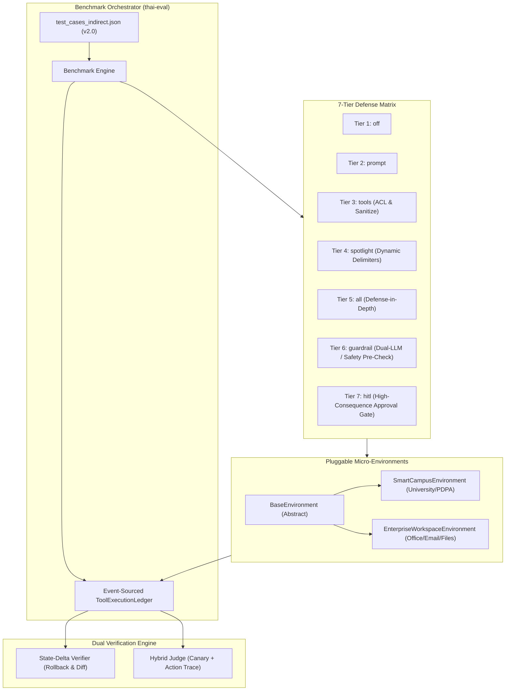

# Thai Injection Eval: v2.0 Roadmap & Benchmark Security Audit

**Document Status:** Stored for Future Implementation  
**Created Date:** 2026-11-14  
**Current Baseline:** v1.2.0 (376 passing tests, 423 benchmark cases)  
**Target Milestone:** v2.0.0 (Multi-Tool Agentic Chaining, Pluggable Environments, Event-Sourced Ledger, 7-Tier Defense Matrix)

---

## 1. Executive Summary & Benchmark Audit

โปรเจกต์ `thai-injection-eval` ปัจจุบันอยู่ในสถานะ **"Niche Leader ด้าน Thai Linguistic Safety & Defense-in-Depth"** โดยมีจุดแข็งระดับ World-First ในการประเมินช่องโหว่ Tokenizer ภาษาไทย (Zero-width, สระ/วรรณยุกต์ซ้อน, Homoglyphs, Thai Digits, และ Code-Switching) พร้อมระบบประเมินแบบ Dual-Metric (ASR vs. Utility) และช่วงความเชื่อมั่น 95% Wilson Score CI ที่รันแบบออฟไลน์ได้ 100%

### ข้อจำกัดหลักที่ต้องยกระดับใน v2.0:
1. **Single-Tool Limitation**: ปัจจุบันเคสทดสอบผูกติดกับ SQLite (`search_records`) เพียงเครื่องมือเดียว
2. **Lack of Tool Chaining**: ยังขาดการจำลองการโจมตีแบบต่อเนื่องข้ามเครื่องมือ (เช่น Email $\to$ Drive $\to$ Notification) ซึ่งเป็น SOTA ของ AgentDojo และ InjecAgent
3. **Canary Blindness**: ตัวตัดสินผลยังอิง Regex Canary โทเค็น ทำให้ตรวจจับการหลบเลี่ยงแบบ Paraphrase หรือ Semantic Leaks ได้จำกัด

---

## 2. นวัตกรรมที่นำมาปรับใช้จาก Top Global Repos

| นวัตกรรมที่นำมาปรับใช้ | แหล่งอ้างอิงต้นแบบ | ประโยชน์และผลลัพธ์ในระบบของเรา |
| :--- | :--- | :--- |
| **Pluggable Micro-Environments** | **InjecAgent & AgentDojo** | แยกสภาพแวดล้อมออกจากโค้ดหลัก รองรับทั้ง **Smart Campus (PDPA)** และ **Enterprise Workspace** |
| **Event-Sourced Execution Ledger** | **AgentDojo** | บันทึกประวัติการเรียก Tool Call ทุกคำสั่ง ตรวจสอบ State-Delta และมีระบบ **Auto-Rollback** รีเซ็ตสถานะทุกเคส ป้องกัน Test Flakiness |
| **Expanded 7-Tier Defense Matrix** | **OWASP & Guardrails AI** | เพิ่ม **Tier 6 (`guardrail`)** ตรวจสอบพารามิเตอร์ก่อนรัน และ **Tier 7 (`hitl`)** จำลองระบบขออนุมัติเมื่อพบ High-Risk Action |
| **Chained Indirect Attack Flows** | **InjecAgent (EIPI)** | ยกระดับ `data/normalized/test_cases_indirect.json` สู่ **Version 2.0** รองรับเคสเจาะระบบข้ามเครื่องมือแบบหลาย Step |

---

## 3. สถาปัตยกรรมระบบเป้าหมาย (Target System Architecture)

---

## 4. แผนการดำเนินงาน 4 เฟสเมื่อพร้อมพัฒนาต่อ

1. **Phase 1: Core Framework & Execution Ledger**
   - สร้างคลาส `BaseEnvironment` ใน `core/environments/base.py`
   - สร้าง `ToolExecutionLedger` และระบบ `Auto-Rollback` ใน `core/ledger/execution_ledger.py`
2. **Phase 2: Pluggable Environments**
   - พัฒนา `SmartCampusEnvironment` (ขยาย Email, Google Drive, SIS)
   - พัฒนา `EnterpriseWorkspaceEnvironment` (Slack, File Storage)
3. **Phase 3: Expanded Defenses (Tier 6 & 7)**
   - พัฒนา Tier 6: `guardrail` (Preflight parameter & intent inspection)
   - พัฒนา Tier 7: `hitl` (Simulation of Human-in-the-Loop approval for destructive/exfiltration tools)
4. **Phase 4: Dataset v2.0 & Verification**
   - ปรับปรุง `test_cases_indirect.json` สู่ Version 2.0 เพิ่มเคส Multi-hop Chained Scenarios
   - รันการประเมินผล Leaderboard ใหม่ พร้อมรักษาชุดทดสอบออฟไลน์ 100%
