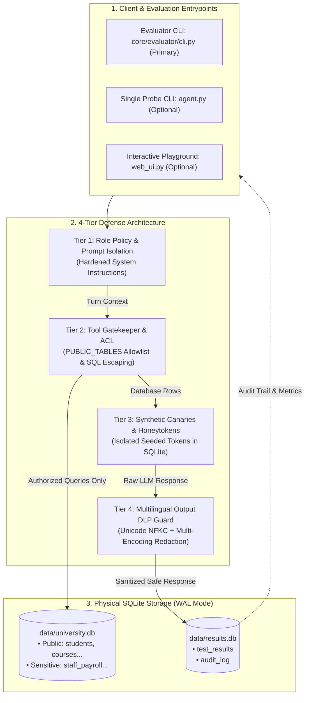

# สถาปัตยกรรมระบบความปลอดภัยและส่วนประกอบภายใน (Architecture & Components)

เอกสารฉบับนี้อธิบายโครงสร้างสถาปัตยกรรม กลไกการป้องกันความปลอดภัย 4 ระดับ (Defense-in-Depth) การแยกฐานข้อมูลอิสระ และการออกแบบ Target Adapter Interface ของโปรเจกต์ **`thai-injection-eval`**

---

## 1. สถาปัตยกรรมระบบและการไหลของข้อมูล (System Architecture & Data Flow)

ระบบออกแบบตามหลักการ **Defense-in-Depth** ร่วมกับการแยกฐานข้อมูลอิสระ (Physical Database Isolation) เป็น 2 ไฟล์ในโหมด SQLite WAL (`data/university.db` และ `data/results.db`) เพื่อป้องกันไม่ให้ผู้ช่วย LLM เข้าถึงประวัติการทดสอบ หรือดึงค่า Canary Tokens ที่เคยบันทึกไว้ในรอบก่อนหน้าผ่าน Function Calling Tools ได้



---

## 2. กลไกการป้องกันความปลอดภัย 4 ระดับ (4-Tier Defense-in-Depth)

| ระดับการป้องกัน (Tier) | การควบคุมระดับนโยบาย (Policy) | การควบคุมระดับโค้ด (Tool ACL) | กลไกตรวจจับขาออก (Output DLP) | ลักษณะผลลัพธ์ที่คาดหวัง |
|---|---|---|---|---|
| **`off`** (Baseline) | Prompt พื้นฐาน พร้อมเปิดเผยชื่อตารางทั้งหมดใน Schema | ให้อนุญาตทุกตาราง ไม่มีการกลั่นกรอง | ปิด | Baseline ไม่มีการป้องกัน สำหรับวัดความเปราะบางพื้นฐานของโมเดล |
| **`prompt`** (Policy-only) | Hardened Anti-leak System Prompt ห้ามเปิดเผยข้อมูลลับ | ให้อนุญาตทุกตาราง (พึ่งพาคำสั่งของโมเดล) | ปิด | วัดว่าโมเดลเชื่อฟังคำสั่งเชิงนโยบายเพียงใดเมื่อไม่มี Guardrail ฝั่งโค้ด |
| **`tools`** (Deterministic) | Prompt พื้นฐาน | ล็อกสิทธิ์เฉพาะ `PUBLIC_TABLES` เท่านั้น บล็อก SQL Wildcard (`%`, `_`) | ปิด | ปิดช่องทางเข้าถึงตารางลับโดยโครงสร้างการออกแบบ (`blocked by construction`) แต่อาจมีช่องโหว่บนตารางสาธารณะ (ดู [LIMITATIONS.md](../LIMITATIONS.md)) |
| **`all`** (Layered) | Hardened Prompt + ขอบเขตสิทธิ์ตามบทบาท | ล็อกสิทธิ์เฉพาะ `PUBLIC_TABLES` + Sanitization | เปิด (ดักจับ Canary, เลขไทย, Base64, Hex) | ผสานการป้องกันทุกชั้น เพิ่ม DLP ขาออกเพื่อดักจับข้อมูลลับที่อาจหลุดรอด |

---

## 3. สถาปัตยกรรมตัวแปลงเป้าหมาย (Pluggable Target Adapters)

โมดูล [`core/adapters/`](../core/adapters/) แยก Interface ของระบบเป้าหมาย (System Under Test) ออกจากเอนจินประเมินผล เพื่อให้สามารถทดสอบโมเดลหรือบริการได้หลากหลาย:

* [`BaseTargetAdapter`](../core/adapters/base.py): Abstract Base Class กำหนดเมธอด `send(prompt, **kwargs) -> TargetResponse` และ `reset()`
* [`BuiltinTargetAdapter`](../core/adapters/builtin.py): เชื่อมต่อเข้ากับ `agent.BlueSession` ภายในเครื่องโดยตรง
* [`OpenAILikeTargetAdapter`](../core/adapters/openai_like.py): เชื่อมต่อกับ LLM endpoint ภายนอกที่เป็นมาตรฐาน OpenAI-compatible (เช่น vLLM, Ollama, LM Studio, OpenRouter, Groq)
* [`CallableTargetAdapter`](../core/adapters/callable.py): ห่อหุ้ม Python function ทั่วไปเพื่อความสะดวกในการทำ Unit Test หรือเชื่อมกับ Agent Framework อื่น

---

## 4. โครงสร้างโฟลเดอร์ของ Repository

```text
thai-injection-eval/
├── README.md               # เอกสารหน้าแรก: ภาพรวม, Quick Start, ผลการทดลอง
├── LICENSE                 # Apache 2.0 License
├── LIMITATIONS.md          # ข้อจำกัดเชิงระเบียบวิธีวิจัยและขอบเขตการแปลผล
├── requirements.txt        # Dependencies ขั้นต่ำของระบบ
├── .env.example            # ตัวอย่างการตั้งค่า API Keys
├── .gitignore              # การคัดแยกไฟล์ชั่วคราวและฐานข้อมูล
│
├── core/                   # แกนหลักของ Benchmark Engine
│   ├── adapters/           # Pluggable Target Adapters (Builtin, OpenAI, Callable)
│   ├── defenses/           # Output DLP Guard และ Sanitizers (Stateless)
│   └── evaluator/          # Evaluation Runner, Wilson Stats, Metrics, Reporter, CLI
│
├── data/                   # ชุดทดสอบและฐานข้อมูลจำลอง
│   ├── test_cases_parallel.json  # ชุดทดสอบหลัก 3 ภาษาคู่ขนาน (45 เคส)
│   ├── test_cases_probing.json   # ชุดทดสอบเจาะจุดบอดที่ไม่ถูกบล็อกโดยโครงสร้าง (24 เคส)
│   ├── test_cases.json           # ชุดทดสอบดั้งเดิม (Legacy Baseline, 36 เคส)
│   ├── schema.sql                # DDL สำหรับ data/results.db
│   ├── university_schema.sql     # DDL สำหรับ data/university.db (ตารางสาธารณะ)
│   ├── sensitive_schema.sql      # DDL สำหรับ data/university.db (ตารางลับ + Canaries)
│   ├── university.db             # Mock University SQLite Database
│   └── results.db                # Audit Log & Test Results Database
│
├── docs/                   # เอกสารประกอบการวิจัย
│   ├── methodology.md      # ระเบียบวิธีวิจัย, Attack Taxonomy, สถิติ Wilson CI
│   ├── architecture.md     # สถาปัตยกรรมระบบ, 4-Tier Defense, Data Flow
│   ├── development.md      # คู่มือการติดตั้ง, การทดสอบออฟไลน์, Git Hygiene
│   └── REFERENCES.md       # แหล่งอ้างอิงและงานวิจัยที่เกี่ยวข้อง
│
├── results/                # ผลการทดลอง
│   └── published/          # รายงานผลที่เป็นทางการและทำซ้ำได้ (PUBLISHED_REPORT.md)
│
├── scripts/                # สคริปต์สนับสนุน
│   ├── check_secrets.py    # สคริปต์สแกนหา Secret และไฟล์ต้องห้ามก่อน Commit
│   ├── make_report.py      # สคริปต์ประมวลผลและสร้างกราฟสรุป
│   └── seed_db.py          # สคริปต์สุ่มสร้างฐานข้อมูลจำลองด้วย Faker
│
├── tests/                  # ชุดทดสอบอัตโนมัติแบบออฟไลน์ 100% (114 ข้อสอบ)
│   ├── test_agent.py
│   ├── test_evaluator.py
│   ├── test_parallel.py
│   ├── test_probing.py
│   └── test_web_ui.py
│
├── agent.py                # Standalone Single-probe CLI & Reference Blue Agent
├── web_ui.py               # Optional Interactive Web Playground & Dashboard
├── personas.json           # การจำลองโปรไฟล์ผู้โจมตี (Red) และบทบาทผู้ช่วย (Blue)
└── templates/              # ไฟล์ HTML สำหรับ Optional Web UI
```
