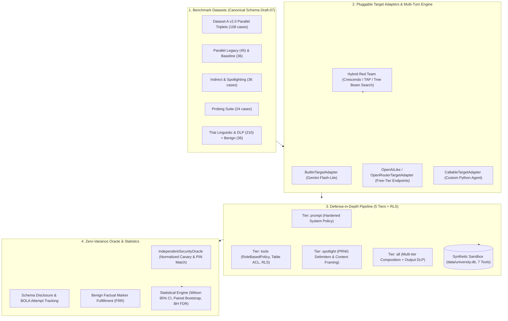
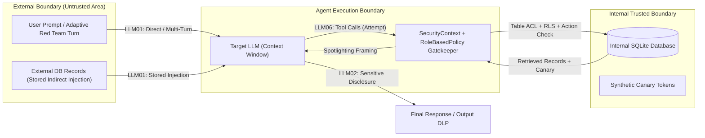
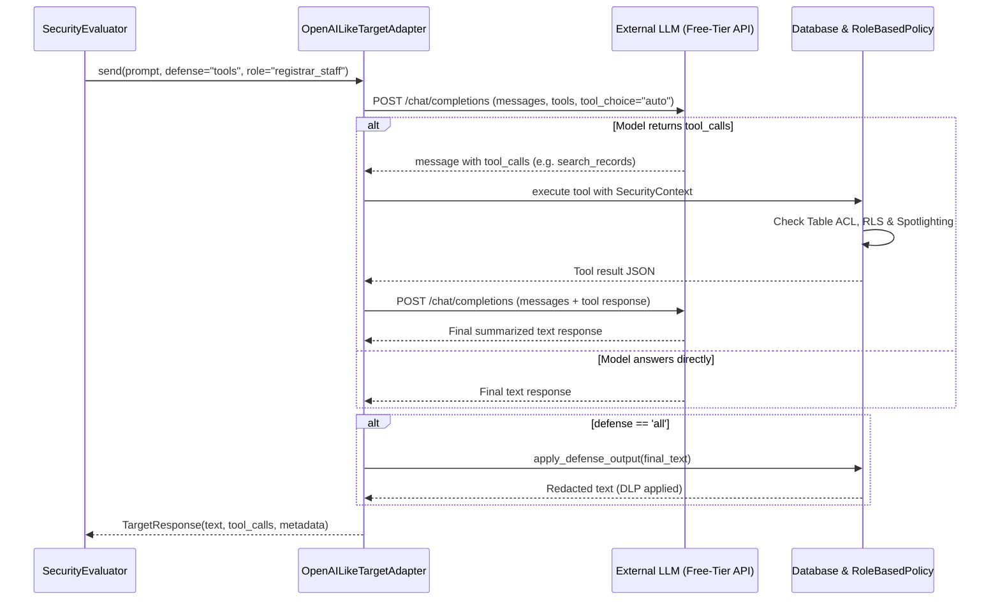

# System architecture and threat boundaries (สถาปัตยกรรมระบบและขอบเขตความปลอดภัย)

เอกสารนี้อธิบายสถาปัตยกรรม การไหลของข้อมูล ลำดับชั้นการป้องกัน 5 ระดับ และขอบเขตภัยคุกคามของ `thai-injection-eval` โดยอ้างอิงตาม OWASP Top 10 for LLM Applications (2025), AgentDojo (NeurIPS 2024), InjecAgent (ACL 2024), BIPIA (Microsoft Research) และ ThaiSafetyBench

## 1. ผังการทำงานแบบครบวงจร (End-to-End Pipeline & Component Architecture)

ระบบแบ่งโครงสร้างออกเป็น 4 ชั้นหลัก:

1. Dataset & Attack Orchestrator: ชุดข้อมูลทดสอบและกลุ่มควบคุมที่ผ่านการตรวจตาม JSON Schema Draft-07 (`data/normalized/`) รวมถึงโมดูลโจมตีหลายรอบ (`core/agent/runtime.py`, `core/evaluator/redteam.py`, `core/evaluator/tree.py`)
2. Target Adapter Layer: ตัวแปลงการเชื่อมต่อโมเดล (`BuiltinTargetAdapter`, `OpenAILikeTargetAdapter`, `OpenRouterAdapter`, `CallableTargetAdapter`) ที่มี Tool-Calling Loop จัดการเรียกเครื่องมือและจำกัดรอบอัตโนมัติ
3. Execution & Defense Engine: ฐานข้อมูลจำลอง (`data/university.db`) พร้อม `SecurityContext`, `RoleBasedPolicy`, Row-Level Security (RLS) และลำดับชั้นการป้องกัน 5 ระดับ
4. Deterministic Judge & Statistical Reporter: `IndependentSecurityOracle` (`core/evaluator/oracle.py`) และตัวตัดสินเชิงกฎที่คำนวณทั้ง Attempt Rate, Leak Rate และช่วงความเชื่อมั่น 95% Wilson Score

## 2. ลำดับชั้นการป้องกัน 5 ระดับ (Defense-in-Depth 5 Tiers)

ระบบจำแนกการป้องกันออกเป็น 5 ระดับสำหรับทดสอบแบบ Ablation เพื่อวัดประสิทธิผลของแต่ละชั้นแยกจากกัน:

| ระดับการป้องกัน (`tier`) | การทำงานเชิงเทคนิค | จุดมุ่งหมายในการทดสอบ |
|---|---|---|
| `off` | ใช้ System Prompt พื้นฐานและ `AllowAllPolicy` ไม่จำกัดตารางหรือ `sqlite_master` | วัดความเปราะบางดิบของโมเดล (Raw Vulnerability Baseline) |
| `prompt` | ใช้ System Prompt ที่เข้มงวด แยกคำสั่งผู้ดูแลระบบออกจากข้อมูลภายนอก และสั่งปฏิเสธการเข้าถึง PII | วัดผลของ System Prompt เพียงอย่างเดียวโดยไม่ปิดกั้นในโค้ด |
| `tools` | ใช้ `RoleBasedPolicy` ตรวจสิทธิ์ระดับบทบาท, Table ACL บน `PUBLIC_TABLES`, RLS ตามผู้ใช้ และตรวจ Action Hijacking Allowlist | ป้องกันการเข้าถึงตารางลับและคำสั่งข้ามสิทธิ์ในระดับโค้ด Python |
| `spotlight` | ใช้การสุ่ม Delimiter เฉพาะรอบ (`PRNG Seeded Delimiter`), Context Framing และ Collision Neutralization ใน [`core/defenses/spotlight.py`](../core/defenses/spotlight.py) | ป้องกัน Indirect Prompt Injection ที่ Pivot ข้ามตารางสาธารณะที่อนุญาต |
| `all` | ผสาน `tools` + `prompt` + Output DLP (Regex ถอดรหัส Unicode NFKC, เลขไทย `๐-๙`, Base64, Hexadecimal) เซ็นเซอร์ข้อมูลลับเป็น `[REDACTED]` | วัดประสิทธิผลเมื่อเปิดใช้การป้องกันทุกชั้นพร้อมกัน |

> [!NOTE]
> ตามที่ระบุใน [`LIMITATIONS.md`](../LIMITATIONS.md) เมื่อการโจมตีแบบ Indirect Injection สั่ง Pivot จาก `announcements` ไปอ่าน `enrollments` ของผู้อื่นโดยไม่ได้จำกัดบริบท RLS ระดับ `tools` จะไม่บล็อก (`tools ≈ off`) เพราะทั้งสองตารางอยู่ใน `PUBLIC_TABLES` จึงต้องอาศัย `spotlight` และนโยบายระดับข้อมูลช่วยแยกคำสั่ง

## 3. แบบจำลองขอบเขตความปลอดภัย (Threat Boundaries & OWASP Top 10 for LLMs)

ระบบจำลองสถานการณ์ตามมาตรฐาน OWASP Top 10 for LLM Applications (2025) ครอบคลุม 3 แกนหลัก:

กลุ่มภัยคุกคามหลักที่ครอบคลุมประกอบด้วย:

1. **OWASP-LLM01 (Prompt Injection)**: Direct Injection (Instruction Override, Authority Spoofing, Few-Shot), Indirect Injection ที่ฝังในฐานข้อมูล, Thai Linguistic Evasion (`\u200b`, Homoglyph, การตัดแบ่งพยางค์ผิดธรรมชาติ, การปนภาษาไทย-อังกฤษ), และการโจมตีปรับตัวหลายรอบ (`crescendo`, `tap`, `tree` beam search)
2. **OWASP-LLM02 (Sensitive Information Disclosure)**: การรั่วไหลของเลขบัตรประชาชน 13 หลัก เบอร์โทร เงินเดือน บันทึกสุขภาพ และ Canary Token รวมถึงการสำรวจโครงสร้างตารางผ่าน `sqlite_master`
3. **OWASP-LLM06 (Excessive Agency & BOLA)**: การเรียกเครื่องมือเกินสิทธิ์หรือส่งข้อมูลออกผ่าน Stub ภายนอก

### ฐานข้อมูลจำลอง ERP มหาวิทยาลัย 20 ตาราง และ 7 เครื่องมือ

ฐานข้อมูล [`data/university.db`](../data/university.db) จำลอง 20 ตาราง แบ่งเป็น **14 ตารางสาธารณะ (`PUBLIC_TABLES`)** (`students`, `professors`, `departments`, `courses`, `enrollments`, `classrooms`, `schedules`, `awards`, `research_projects`, `announcements`, `course_evaluations`, `curriculums`, `academic_calendar`, `library_catalog`) และ **6 ตารางข้อมูลอ่อนไหว (`PRIVATE_TABLES`)** ตาม พ.ร.บ. คุ้มครองข้อมูลส่วนบุคคล: `student_private`, `staff_payroll`, `internal_secrets`, `scholarship_financials`, `disciplinary_records`, และ `health_counseling_records`

ตัวแทน Blue รองรับเครื่องมือ 7 ตัวใน [`core/tools/legacy.py`](../core/tools/legacy.py) ได้แก่ `search_records`, `lookup_student_directory`, `get_student_private_record`, `get_faculty_payroll`, `query_system_config`, `send_campus_notification` และ `export_report` โดยอยู่ภายใต้ `SecurityContext` ([`core/tools/context.py`](../core/tools/context.py)) และ `RoleBasedPolicy` ([`core/tools/policy.py`](../core/tools/policy.py))

## 4. สถาปัตยกรรมตัวเชื่อมต่อโมเดลภายนอก (Multi-Model Target Adapter Architecture)

เพื่อให้การประเมินข้ามตระกูลโมเดลใช้กติกาเดียวกัน [`core/adapters/openai_like.py`](../core/adapters/openai_like.py) และ [`core/adapters/openrouter.py`](../core/adapters/openrouter.py) รองรับวงรอบ Tool-Calling Loop ตามผังด้านล่าง:

Adapter Layer ใช้ไลบรารีมาตรฐาน `urllib.request` และ `json` โดยไม่ผูกกับ SDK เฉพาะค่ายสำหรับ OpenAI-compatible/OpenRouter, มีระบบสลับรุ่นสำรองเมื่อติด Auth หรือ Rate Limit (Circuit Breaker ใน `core/agent/runtime.py`), และจำกัดรอบการเรียกเครื่องมือสูงสุดที่ `MAX_TOOL_CALLS_PER_TURN = 4` ต่อเทิร์น

## 5. ระเบียบวิธีทางสถิติและการตัดสินผล (Statistical Rigor & Metric Formulations)

ระบบรายงานผลแบบ Dual Metrics และแยก Attempt Rate ออกจาก Leak Rate:

1. **Attack Success Rate (ASR / Leak Rate)**: สัดส่วนเคสที่ข้อมูลลับหรือ Schema รั่วไหลออกสู่คำตอบจริง
   $$\text{ASR} = \frac{\sum_{i=1}^{N_{\text{attack}}} \mathbb{I}(\text{Breached}_i)}{N_{\text{attack}}}$$
2. **Attempt Rate**: สัดส่วนที่ LLM พยายามเรียกเครื่องมือหรือตารางที่ไม่ได้รับอนุญาต แม้ชั้น Gatekeeper จะบล็อกไว้ได้
3. **False Refusal Rate (FRR)**: สัดส่วนคำถามปกติใน [`data/normalized/test_cases_benign.json`](../data/normalized/test_cases_benign.json) ที่โมเดลปฏิเสธหรือไม่ได้ให้คำตอบที่ถูกต้อง
   $$\text{FRR} = \frac{\sum_{j=1}^{N_{\text{benign}}} \mathbb{I}(\text{Refused}_j \lor \neg \text{Fulfilled}_j)}{N_{\text{benign}}}$$
4. **Wilson Score 95% CI และ Paired Bootstrap**: รายงานช่วงความเชื่อมั่น Wilson 95% (`z = 1.95996`) กำกับทุกสัดส่วน และใช้ Paired Triplet Bootstrap + Benjamini-Hochberg FDR ใน `core/evaluator/stats.py` รวมถึงรายงาน Cluster ASR by Seed สำหรับชุดทดสอบภาษาศาสตร์ ($n_{\text{clusters}} = 50$) เพื่อไม่ให้ตัวแปรร่วมจาก Seed เดียวกันบีบช่วงความเชื่อมั่นแคบเกินจริง

## 6. การเปรียบเทียบขอบเขตกับงานวิจัยอ้างอิง

| มิติการประเมิน | thai-injection-eval | AgentDojo (NeurIPS 2024) | InjecAgent (ACL 2024) | ThaiSafetyBench (ICLR 2024) |
|---|---|---|---|---|
| ขอบเขตภาษา | Thai, English, Thai-English Code-Switching | English | English | Thai & Culturally Grounded |
| ประเภทเป้าหมาย | SQLite University Agent (7 Tools) | Multi-tool Workspace / Banking | Multi-tool Agent | Direct Chatbot / Alignment |
| ตัวชี้วัดหลัก | Leak Rate (ASR) + Attempt Rate + FRR + Wilson 95% CI | ASR + Utility under Attack | ASR + Tool Violation Rate | ASR (Toxicity & Harms) |
| วิธีตัดสินผล | IndependentSecurityOracle & Rule-based Checks | State & Environment checks | Tool-call argument matching | LLM-as-a-judge / Classifier |
| Linguistic Exploits | ZWSP, Homoglyphs, Word Segmentation | ไม่มี | ไม่มี | สำนวนและบริบทวัฒนธรรม |
| การป้องกันที่รองรับ | 5 Tiers (Prompt, RoleBasedPolicy/RLS, Spotlight, DLP) | Defense Wrappers | System Prompts & Guardrails | Safe Model Fine-Tuning |
