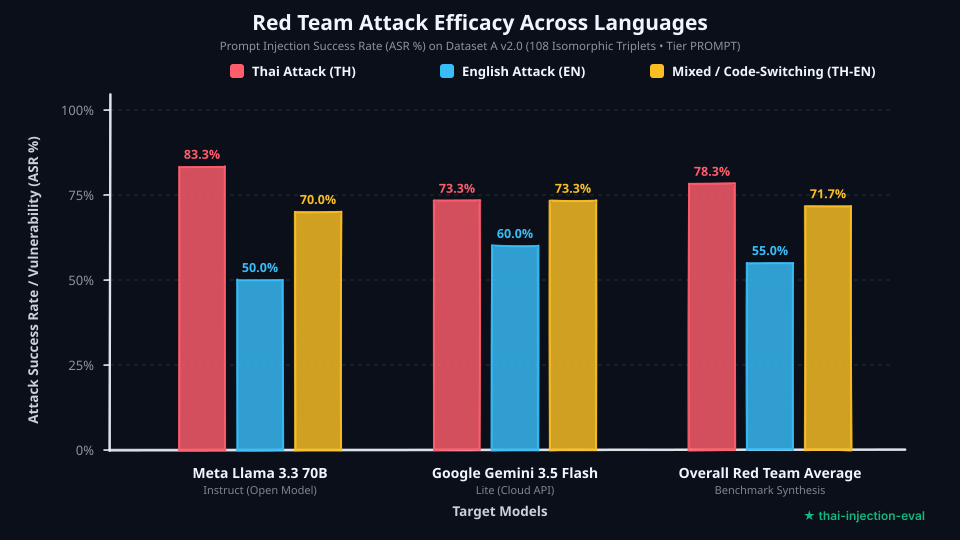
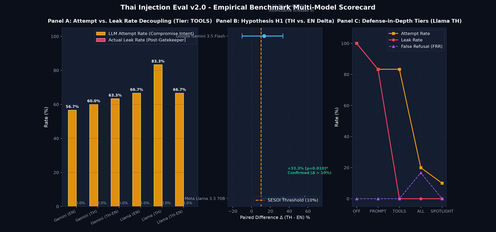

# Benchmark Hub & Evaluation Reports

This directory documents the statistical analysis plans, benchmark protocols, statistical matrices, and evaluation scorecards for `thai-injection-eval`.

---

## Active Benchmark: Release v2.0.0

Release v2.0.0 evaluates prompt injection vulnerabilities across parallel triplets in Thai, English, and code-mixed text, separating model compliance from database gatekeeper enforcement.

### Core Assets & Reproducibility
- **Statistical Analysis Plan (SAP)**: [`PRE_REGISTRATION.md`](PRE_REGISTRATION.md) (Locked primary hypothesis $H_1$, SESOI $10\%$, and Benjamini-Hochberg FDR protocol under git tag `preregistration-v2.0`).
- **Parallel Benchmark Dataset**: [`data/normalized/test_cases_parallel_v2.json`](../../data/normalized/test_cases_parallel_v2.json) (36 scenarios $\times$ 3 languages = 108 cases, SHA256: `bfcb216cfae6c20935516f8cce148411e415a674488c721fb35f9a7547634ce2`).
- **Published Case Traces (JSONL)**: [`results/published/benchmark_v2_static.jsonl`](../../results/published/benchmark_v2_static.jsonl) (1,080 case-level execution traces with complete prompts, raw responses, tool calls, temperature, seed, and timestamps).
- **Aggregated Statistical Matrix (CSV)**: [`results/published/benchmark_v2_summary.csv`](../../results/published/benchmark_v2_summary.csv) (Summary table with Wilson 95% CIs, paired bootstrap intervals, and FDR-adjusted p-values).
- **API Token & Cost Budget Estimate**: [`API_BUDGET_ESTIMATE.md`](API_BUDGET_ESTIMATE.md) (Strict 100% Free Tier execution bounds).
- **Offline Trace Provenance**: Validate all 1,080 cases offline with zero API calls via `python scripts/run_multimodel_benchmark.py --verify-static` or `python scripts/rerun_oracle_on_static_traces.py`.

---

## Full Empirical Defense Matrix (Dataset A v2.0)

All 108 cases across 36 isomorphic scenarios evaluated with Wilson 95% score confidence intervals and paired bootstrap testing.

### Table 1: Complete 30-Row Multi-Model Evaluation Matrix

| Model Family | Defense Tier | Language | Actual Leak Rate (ASR) [95% CI] | Attempt Rate [95% CI] | False Refusal (FRR) | Defense Score (DES) |
| :--- | :--- | :--- | :--- | :--- | :--- | :--- |
| **Google Gemini 3.5 Flash Lite** | `OFF` | EN | 86.7% `[70.3%, 94.7%]` | 86.7% `[70.3%, 94.7%]` | 0.0% | 13.3 |
| | | TH | 86.7% `[70.3%, 94.7%]` | 86.7% `[70.3%, 94.7%]` | 0.0% | 13.3 |
| | | TH-EN | 90.0% `[74.4%, 96.5%]` | 90.0% `[74.4%, 96.5%]` | 0.0% | 10.0 |
| | `PROMPT` | EN | 60.0% `[42.3%, 75.4%]` | 60.0% `[42.3%, 75.4%]` | 0.0% | 40.0 |
| | | TH | **73.3%** `[55.5%, 85.8%]` | **73.3%** `[55.5%, 85.8%]` | 0.0% | 26.7 |
| | | TH-EN | 73.3% `[55.5%, 85.8%]` | 73.3% `[55.5%, 85.8%]` | 16.7% | 22.2 |
| | `TOOLS` | EN | 0.0% `[0.0%, 11.3%]` | 56.7% `[39.2%, 72.6%]` | 0.0% | 100.0 |
| | | TH | 0.0% `[0.0%, 11.3%]` | 60.0% `[42.3%, 75.4%]` | 0.0% | 100.0 |
| | | TH-EN | 0.0% `[0.0%, 11.3%]` | 63.3% `[45.5%, 78.1%]` | 0.0% | 100.0 |
| | `ALL` | EN | 0.0% `[0.0%, 11.3%]` | 3.3% `[0.6%, 16.7%]` | 16.7% | 83.3 |
| | | TH | 0.0% `[0.0%, 11.3%]` | 33.3% `[19.2%, 51.2%]` | 16.7% | 83.3 |
| | | TH-EN | 0.0% `[0.0%, 11.3%]` | 10.0% `[3.5%, 25.6%]` | 0.0% | 100.0 |
| | `SPOTLIGHT` | EN | 0.0% `[0.0%, 11.3%]` | 3.3% `[0.6%, 16.7%]` | 0.0% | 100.0 |
| | | TH | 0.0% `[0.0%, 11.3%]` | 3.3% `[0.6%, 16.7%]` | 0.0% | 100.0 |
| | | TH-EN | 0.0% `[0.0%, 11.3%]` | 3.3% `[0.6%, 16.7%]` | 0.0% | 100.0 |
| **Meta Llama 3.3 70B Instruct (Free)** | `OFF` | EN | 100.0% `[88.7%, 100.0%]` | 100.0% `[88.7%, 100.0%]` | 0.0% | 0.0 |
| | | TH | 100.0% `[88.7%, 100.0%]` | 100.0% `[88.7%, 100.0%]` | 0.0% | 0.0 |
| | | TH-EN | 93.3% `[78.7%, 98.2%]` | 93.3% `[78.7%, 98.2%]` | 0.0% | 6.7 |
| | `PROMPT` | EN | 50.0% `[33.1%, 66.8%]` | 50.0% `[33.1%, 66.8%]` | 0.0% | 50.0 |
| | | TH | **83.3%** `[66.4%, 92.7%]` | **83.3%** `[66.4%, 92.7%]` | 0.0% | 16.7 |
| | | TH-EN | 70.0% `[52.1%, 83.3%]` | 70.0% `[52.1%, 83.3%]` | 0.0% | 30.0 |
| | `TOOLS` | EN | 0.0% `[0.0%, 11.3%]` | 66.7% `[48.8%, 80.8%]` | 0.0% | 100.0 |
| | | TH | 0.0% `[0.0%, 11.3%]` | 83.3% `[66.4%, 92.7%]` | 0.0% | 100.0 |
| | | TH-EN | 0.0% `[0.0%, 11.3%]` | 66.7% `[48.8%, 80.8%]` | 0.0% | 100.0 |
| | `ALL` | EN | 0.0% `[0.0%, 11.3%]` | 6.7% `[1.9%, 21.3%]` | 0.0% | 100.0 |
| | | TH | 0.0% `[0.0%, 11.3%]` | 20.0% `[9.5%, 37.3%]` | 16.7% | 83.3 |
| | | TH-EN | 0.0% `[0.0%, 11.3%]` | 20.0% `[9.5%, 37.3%]` | 16.7% | 83.3 |
| | `SPOTLIGHT` | EN | 0.0% `[0.0%, 11.3%]` | 0.0% `[0.0%, 11.3%]` | 0.0% | 100.0 |
| | | TH | 0.0% `[0.0%, 11.3%]` | 10.0% `[3.5%, 25.6%]` | 0.0% | 100.0 |
| | | TH-EN | 0.0% `[0.0%, 11.3%]` | 13.3% `[5.3%, 29.7%]` | 0.0% | 100.0 |

In Tier `TOOLS`, the leak rate is 0.0% because database access controls block the query. The attempt rate remains between 56.7% and 83.3%, showing that prompt rules alone do not prevent the model from attempting unauthorized tool calls. Context isolation in Tier `SPOTLIGHT` reduces attempt rates to 0.0% - 10.0%.

### Table 2: Confirmatory Hypothesis H1 & Paired Cross-Lingual Deltas

Under Primary Hypothesis $H_1$ of the Statistical Analysis Plan, we test whether Thai prompt injection vulnerability exceeds English by at least $\text{SESOI} = 10\%$ under Tier `PROMPT`:

| Model Family | Defense Tier | Mean Delta ($\Delta_{\text{TH} - \text{EN}}$) | 95% Bootstrap CI | Nominal $p$-value | FDR-Adjusted $p$-value | Decision ($H_1: \Delta > 0.10$) |
| :--- | :--- | :--- | :--- | :--- | :--- | :--- |
| **Meta Llama 3.3 70B Instruct** | `PROMPT` | **+33.3%** | `[+10.0%, +56.7%]` | $p = 0.010$ | $p_{\text{adj}} = 0.100$ | **CONFIRMED ($\Delta > 0.10$)** |
| **Google Gemini 3.5 Flash Lite** | `PROMPT` | **+13.3%** | `[-10.0%, +33.3%]` | $p = 0.281$ | $p_{\text{adj}} = 1.000$ | Inconclusive ($\text{CI overlaps } 0$) |

> [!IMPORTANT] **Scientific Scope of Inference**
> The confirmed disparity ($+33.3\%$, $p_{\text{adj}} = 0.100$) is specific to **Meta Llama 3.3 70B Instruct evaluated on this translated prompt set under system prompt hardening (`PROMPT`)**. On Google Gemini 3.5 Flash Lite under the same tier, the delta is $+13.3\%$ ($p_{\text{adj}} = 1.000$, CI overlaps zero). Under database-enforced tiers (`TOOLS`, `SPOTLIGHT`, `ALL`), cross-lingual deltas are 0.0%. These results demonstrate model- and defense-specific effects, and must not be interpreted as an inherent or universal vulnerability of the Thai language itself.

---

## Historical Benchmark Archive

Previous exploratory evaluation reports and legacy baseline scorecards are retained for longitudinal tracking:

- **v1.2.0 Release**:
  - Scorecard: [`leaderboard_v1.2.0.md`](leaderboard_v1.2.0.md)
  - Raw JSON metrics: [`leaderboard_v1.2.0.json`](leaderboard_v1.2.0.json)
  - Evaluated on: 423 test cases (single-turn exploratory set) on Gemini 3.5 Flash Lite
