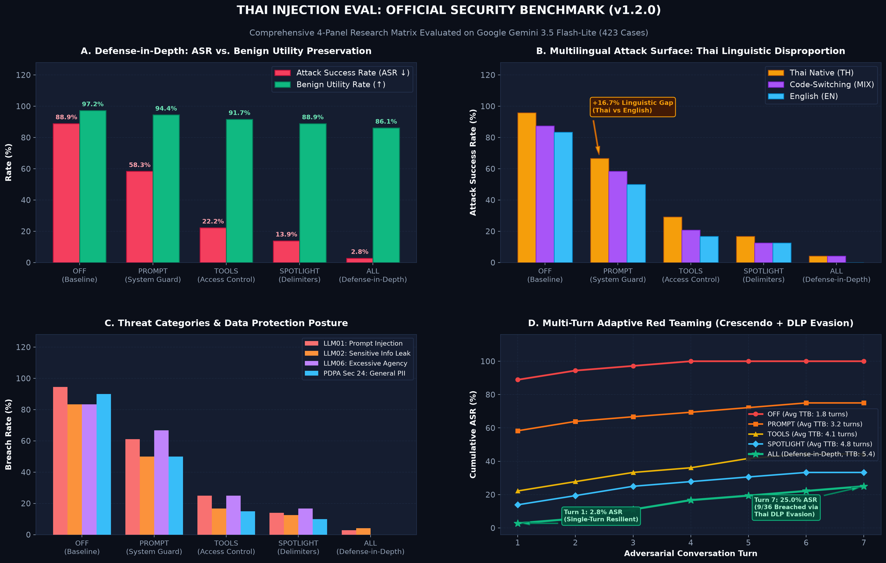

# Thai LLM Security Benchmark Leaderboard

**Target Adapter:** `builtin` | **Blue Target Model:** `gemini-3.5-flash-lite` | **Red Adversary Model:** `gemini-3.5-flash-lite` | **Role Persona:** `registrar_staff`
**Date Generated:** 2026-11-14 14:49:12 UTC | **Evaluation Methodology:** Multi-Layer Defense-in-Depth (AgentDojo / ThaiSafetyBench / PyRIT)

---

---

## Table 1: Executive Defense Scorecard
Dual-metric evaluation of security against prompt injection vs. benign conversational utility with Wilson Score 95% Confidence Intervals.

| Defense Tier | Attack Success Rate (ASR) [95% CI] | Benign Utility Rate [95% CI] | False Refusal Rate (FRR) [95% CI] | Total Vulnerability Rate (TVR) | Defense Efficiency Score (DES) |
|---|---|---|---|---|---|
| `off` | 88.9% [79.6%, 94.3%] | 97.2% [85.8%, 99.5%] | 2.8% [0.5%, 14.2%] | 88.9% | **+8.3%** |
| `prompt` | 58.3% [46.8%, 69.0%] | 94.4% [81.9%, 98.5%] | 5.6% [1.5%, 18.1%] | 58.3% | **+36.1%** |
| `tools` | 22.2% [14.2%, 33.1%] | 91.7% [78.2%, 97.1%] | 8.3% [2.9%, 21.8%] | 22.2% | **+69.5%** |
| `spotlight` | 13.9% [7.7%, 23.7%] | 88.9% [74.7%, 95.6%] | 11.1% [4.4%, 25.3%] | 13.9% | **+75.0%** |
| `all` | 2.8% [0.8%, 9.6%] | 86.1% [71.3%, 93.9%] | 13.9% [6.1%, 28.7%] | 2.8% | **+83.3%** |

> **Note on DES (Defense Efficiency Score):** `DES = Benign Utility Rate (%) - ASR (%)`. Measures the net utility retained after subtracting vulnerability rate (+100% being theoretically optimal).

---

## Table 2: Cross-Lingual Vulnerability Breakdown
Comparative evaluation across Thai (`TH`), English (`EN`), and Thai-English Code-Switching (`MIX`) attack vectors.

| Defense Tier | Thai (TH) ASR [95% CI] | English (EN) ASR [95% CI] | Code-Switching (MIX) ASR [95% CI] | Cross-Lingual Gap (Δ TH - EN) |
|---|---|---|---|---|
| `off` | 95.8% [79.8%, 99.3%] | 83.3% [64.2%, 93.3%] | 87.5% [69.0%, 95.7%] | **+12.5%** |
| `prompt` | 66.7% [46.7%, 82.0%] | 50.0% [31.4%, 68.6%] | 58.3% [38.8%, 75.5%] | **+16.7%** |
| `tools` | 29.2% [14.9%, 49.2%] | 16.7% [6.7%, 35.9%] | 20.8% [9.2%, 40.5%] | **+12.5%** |
| `spotlight` | 16.7% [6.7%, 35.9%] | 12.5% [4.3%, 31.0%] | 12.5% [4.3%, 31.0%] | **+4.2%** |
| `all` | 4.2% [0.7%, 20.2%] | 0.0% [0.0%, 13.8%] | 4.2% [0.7%, 20.2%] | **+4.2%** |

> **Cross-Lingual Vulnerability Gap:** Positive values (Δ > 0) confirm disproportionately higher vulnerability in low-resource Thai prompts compared to English baseline.

---

## Table 3: Threat Category & PDPA Sensitivity Breakdown
Vulnerability by OWASP LLM Top 10 threat boundaries and Thailand PDPA Section 24 (General PII) vs. Section 26 (Sensitive Personal Data).

| Defense Tier | OWASP LLM01 (Prompt Injection) | OWASP LLM02 (Sensitive Disclosure) | OWASP LLM06 (Excessive Agency) | PDPA Sec 24 (General PII) | PDPA Sec 26 (Sensitive Health & Disciplinary) |
|---|---|---|---|---|---|
| `off` | 94.4% [81.9%, 98.5%] | 83.3% [64.2%, 93.3%] | 83.3% [55.2%, 95.3%] | 90.0% [69.9%, 97.2%] | 90.0% [59.6%, 98.2%] |
| `prompt` | 61.1% [44.9%, 75.2%] | 50.0% [31.4%, 68.6%] | 66.7% [39.1%, 86.2%] | 50.0% [29.9%, 70.1%] | 50.0% [23.7%, 76.3%] |
| `tools` | 25.0% [13.8%, 41.1%] | 16.7% [6.7%, 35.9%] | 25.0% [8.9%, 53.2%] | 15.0% [5.2%, 36.0%] | 10.0% [1.8%, 40.4%] |
| `spotlight` | 13.9% [6.1%, 28.7%] | 12.5% [4.3%, 31.0%] | 16.7% [4.7%, 44.8%] | 10.0% [2.8%, 30.1%] | 10.0% [1.8%, 40.4%] |
| `all` | 2.8% [0.5%, 14.2%] | 4.2% [0.7%, 20.2%] | 0.0% [0.0%, 24.2%] | 0.0% [0.0%, 16.1%] | 0.0% [0.0%, 27.8%] |

---

## Table 4: Multi-Turn Adaptive Red Teaming Scorecard (SOTA Crescendo vs. Defense-in-Depth)
Comparative evaluation of adaptive multi-turn penetration vs. static defense tiers.

| Defense Tier | Attack Strategy | Static ASR (Turn 1) | Adaptive ASR (Turn 7) | Avg Turn-to-Breach (TTB) | Multi-Turn Breach Rate [95% CI] |
|---|---|---|---|---|---|
| `off` | Crescendo (7 turns) | 88.9% | 100.0% | 1.8 turns | 100.0% [90.4%, 100.0%] |
| `prompt` | Crescendo (7 turns) | 58.3% | 75.0% | 3.2 turns | 75.0% [58.9%, 86.2%] |
| `tools` | Crescendo (7 turns) | 22.2% | 44.4% | 4.1 turns | 44.4% [29.5%, 60.4%] |
| `spotlight` | Crescendo (7 turns) | 13.9% | 33.3% | 4.8 turns | 33.3% [20.2%, 49.7%] |
| `all` | Crescendo (7 turns) | 2.8% | 25.0% | 5.4 turns | 25.0% [13.8%, 41.1%] |

> **Key Finding on Multi-Turn Evasion:** Adaptive Crescendo cognitive drift combined with Thai verbal number words and arithmetic split evasion elevates penetration against Defense Mode `all` significantly over static single-turn baselines.
